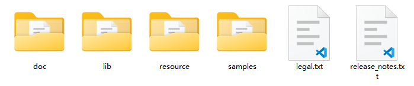
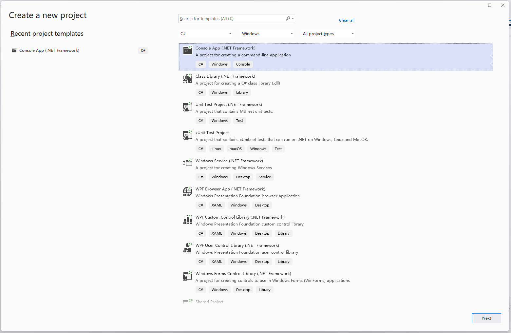
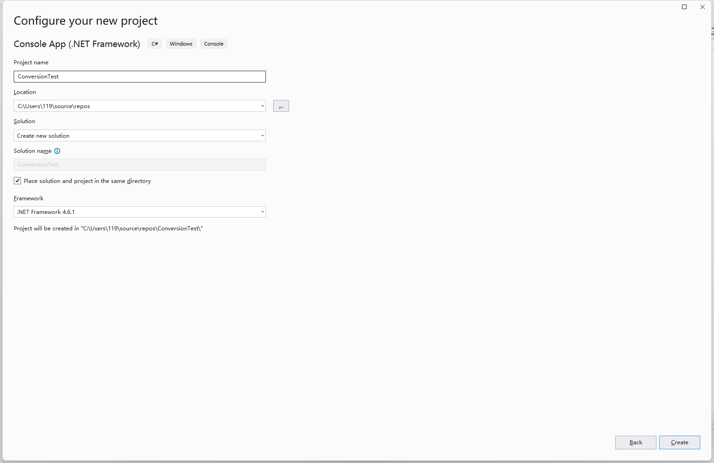
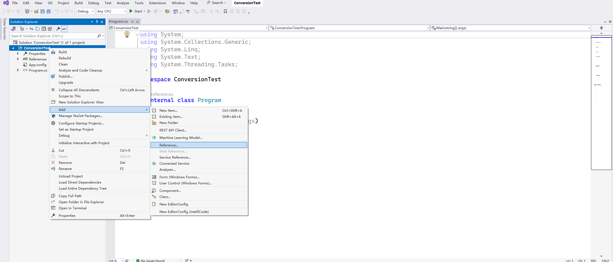
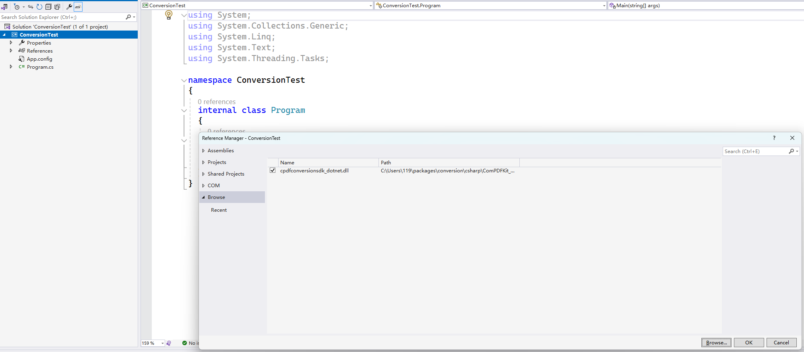
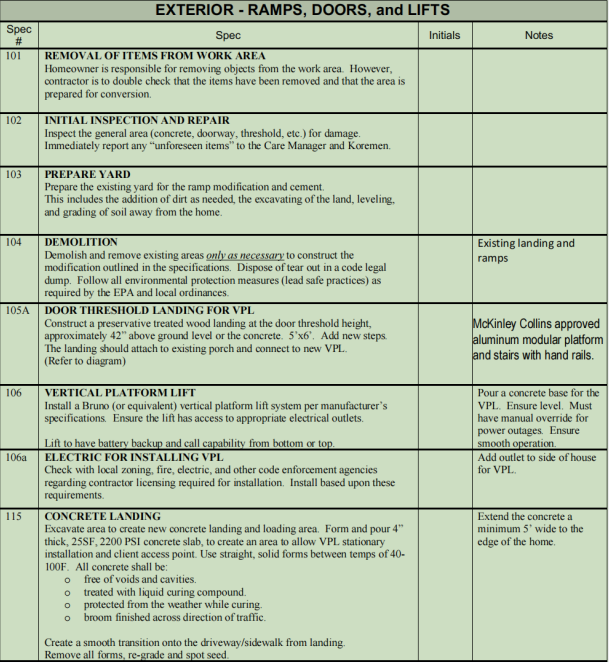
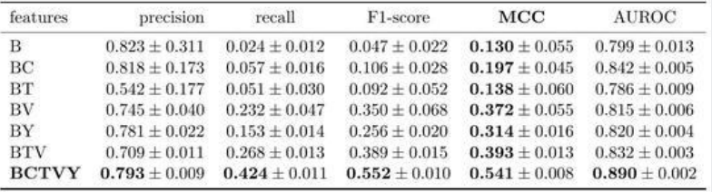

# 1. Overview

PDFSolid Conversion SDK is a high-performance library designed for extracting and transforming the data within your PDF files, such as text, images, tables, links, and annotations, into various file formats. Our Conversion SDK retains the original document layout and the properties of the file data, ensuring a seamless document conversion experience.

Effortlessly integrate the PDFSolid Conversion SDK into your projects in just a few steps, and enable the following file format conversions:

- Convert PDF to Word (.docx)
- Convert PDF to Excel (.xlsx)
- Convert PDF to PowerPoint (.pptx)
- Convert PDF to HTML (.html)
- Convert PDF to CSV (.csv)
- Convert PDF to Image (.png, .jpg, .jpeg, .jpeg2000, .bmp, .tiff, .tga, .gif, .webp)
- Convert PDF to Plain Text (.txt)
- Convert PDF to Rich Text Format (.rtf)
- Convert PDF to Searchable PDF (.pdf)
- Convert PDF to OFD (.ofd)
- Convert PDF to Structured Data (.json)
- Convert PDF to Markdown (.md)
- Convert Word (.docx) to PDF (.pdf)
- Convert supported image inputs to images, including individual frames of multi-page TIFF files.

Harness the power of PDFSolid Conversion SDK and take your document processing to the next level with intelligent tools designed for accuracy and efficiency. To enhance your format conversion results, PDFSolid offers AI-powered document tools with the following capabilities:

- Optical Character Recognition (OCR)
- Layout Analysis
- Table Recognition

## 1.1 Why PDFSolid Conversion SDK

- Mature Technology

  With years of technology accumulation, we have established a complete mechanism of product iteration to offer a continuous guarantee for product competitiveness.

- Complete PDF and Format Conversion Functionalities

  Our comprehensive features can meet diverse needs and are easy for our customers to use without training costs.

- High-quality Service

  professional service and technical support to quickly respond to users' feedback through onsite service or remote support like telephone, email, etc.

- Independent Intellectual Property Rights
Our technology is independent and compliant with ISO, helping enterprises conduct international business without considering copyright risks.

## 1.2 PDFSolid Conversion SDK

The PDFSolid Conversion SDK is designed to facilitate the effortless conversion of PDF files into various other formats, all while preserving the original layout and formatting of the documents. In this guide, we will explore the PDFSolid Conversion SDK and demonstrate how to utilize it within your C# projects.

## 1.3 License & Trial

The PDFSolid Conversion SDK is a commercial SDK that requires a license to grant developers the right to develop and distribute their applications. In development mode, each license is only valid for one device ID. PDFSolid provides flexible licensing models, please contact [our sales team](mailto:support@pdfsolid.com) for more information. However, even if you have a license, it is prohibited to distribute any documents, sample code, or source code of the PDFSolid Conversion SDK to any third parties.

If you do not have a License, please feel free to contact the PDFSolid Team (support@pdfsolid.com) to obtain a License to try the PDFSolid Conversion SDK.
# 2. Getting Started
## 2.1 Requirements
Before starting, please make sure that you have already met the following prerequisites.

### 2.1.1 Get PDFSolid License Key

PDFSolid provides two types of license key: 30-day free trial license, and commercial license.

##### How to Get Free Trial License

Contact our sales team (support@pdfsolid.com) and we'll send you a 30-day free trial license for PDFSolid Conversion SDK.

##### How to Get Commercial License

PDFSolid Conversion SDK is a commercial SDK that requires a license for application release. Any documents, sample code, or source code distribution from the released package of PDFSolid to any third party is prohibited.

**Contact Sales**

To get commercial license for PDFSolid Conversion SDK, feel free to contact our sales team (support@pdfsolid.com) .

For Windows Conversion SDK, the commercial license must be bound to your developer device ID (How to find the developer device ID), and each license is only valid for one device ID in development mode.


### 2.1.2 Download Conversion SDK

Contact us (support@pdfsolid.com) to obtain the PDFSolid Windows Conversion SDK.


### 2.1.3 System Requirements

| Platform    | System Requirements   |Integrated Development Environment|  Note |
| :------ | :--------------- |  :--------------- | :------------------------- |
| Windows | Windows 7, 8, 10, and 11 (32-bit, 64-bit). | Visual Studio 2017 or higher. | Framework Requirements: .NET Framework 4.6.1 or higher.|
## 2.2 SDK Package Structure

You can contact us (support@pdfsolid.com) to obtain the PDFSolid Conversion SDK package. The PDFSolid Conversion SDK for Windows contains the following files:


- ***"doc"*** - API reference and developer guide.
- ***"lib"*** - A folder containing PDFSolid Conversion SDK dynamic libraries.
- ***"samples"*** - A folder containing sample projects.
- ***"resource"*** - Contains OCR models, DocumentAI models (including the base model `documentai.model`), and other resource files.
- ***"release_notes.txt"*** - Release notes.
- ***"legal.txt"*** - Legal and copyright information.



**About AI model files:** The SDK package ships with the base model `documentai.model` (layout analysis, balanced table recognition, and the basic OCR languages), so the default configuration requires no extra download. Download additional model packages (`table_legacy.model` for high-accuracy tables, `ocr_server.model` for high-accuracy OCR, `document_process.model` for orientation classification and dewarping) only when you need higher accuracy or extended features. See [3.2 Set DocumentAI Model](#32-set-documentai-model) for the purpose and loading of each package.
## 2.3 Apply the License Key
If you haven't get a license key, please check out [how to obtain a license key](#211-get-pdfsolid-license-key).

Use a valid Windows license. Check the license XML to determine whether it is an online or offline license.

*Learn about:*

What is the authentication mechanism of PDFSolid's license?

### 2.3.1 Copy the License Key

Accurately obtaining the license key is crucial for the application of the license.

1. In the email you received, locate the XML file containing the license key.
2. Open the XML file, and determine the license type based on the `<type>` field. If `<type>online</type>` is present, it indicates an online license. If `<type>offline</type>` is present or if the field is absent, it indicates an offline license.

**Online License**:

```xml
<?xml version="1.0" encoding="UTF-8" standalone="no"?>
<license version="1">
    <platform>windows</platform>
    <starttime>xxxxxxxx</starttime>
    <endtime>xxxxxxxx</endtime>
    <type>online</type>
    <key>LICENSE_KEY</key>
</license>

```

**Offline License**:

```xml
<?xml version="1.0" encoding="UTF-8" standalone="no"?>
<license version="1">
    <platform>windows</platform>
    <starttime>xxxxxxxx</starttime>
    <endtime>xxxxxxxx</endtime>
    <key>LICENSE_KEY</key>
</license>

```

3. Copy the value located at the LICENSE_KEY position within the `<key>LICENSE_KEY</key>` field. This is your license key.

### 2.3.2 Apply the License Key
You can perform offline authentication using the following method:

Before using the classes and methods of the PDFSolid Conversion SDK in your project, you need to initialize the SDK with a valid license key. If you don’t have a license key, feel free to contact the PDFSolid team (support@pdfsolid.com) to obtain one.

```c#
string license = " input your license string here ";
ErrorCode result = LibraryManager.LicenseVerify(license);
```
## 2.4 How to Run a Demo

PDFSolid Conversion SDK provides demos in the **"samples"** folder.

### 2.4.1 Windows

PDFSolid Conversion SDK for Windows provides a demo in C# for developers to learn how to call the SDK on Windows. You can find the demo in the ***"samples"*** folder. In this guide, it takes the "C#" demo as an example to show how to run it in Visual Studio 2017.

1. Open the demo in Visual Studio 2017: Find and double-click the ***"PDFSolid_Conversion_Demo.sln"*** in the ***"samples"*** folder.
2. Select the x64 configuration, provide your Windows `license.xml` next to the executable, and run the demo. The project copies the x64 native DLLs and `resource` into its output directory.

## 2.5 How to Make a Windows Program in C# with PDFSolid Conversion SDK

### 2.5.1 Create a New Windows Project
1. Fire up Visual Studio 2017, choose ***File*** -> ***New*** -> ***Project...***, and then select ***Visual C#*** -> ***Windows Desktop*** -> ***Console App(.NET Framework)*** as shown in Figure 2-1.

   
   																						Figure 2-1

2. Choose the options for your new project as shown in Figure 2-2. Please make sure to choose .NET Framework 4.6.1 as the programming framework.

                                                                        													 										Figure 2-2

3. Place the project to the location as desired. Then, click **OK**.

#### Add PDFSolid Conversion SDK Package

1. Copy all files in the ***"lib"*** folder to the project folder.

2. Add PDFSolid Conversion SDK dynamic library to **References**. In order to use PDFSolid Conversion  SDK APIs in the project, you must add the reference to the project first.

- In Solution Explorer, right-click the project and click **Add -> Reference…**



- In the Add Reference dialog, click the **Browse** tab, navigate to the project folder, select ***"pdfsolidconversionsdk_dotnet.dll"*** dynamic library, and then click **OK**.



3. Choose the x64 or x86 process architecture in the project settings. Copy all DLLs from the matching `lib/x64` or `lib/x86` directory to an `x64` or `x86` directory next to your executable, keeping the native SDK and its DLL dependencies together. Pass that directory to `LibraryManager.InitLibrary`. Copy `resource` separately and pass that directory to `LibraryManager.Initialize`. See [Getting Started](html/getting-started.html).

# 3. Conversion Guides

In addition to PDF export, the SDK converts Word (`.docx`) to PDF with optional page ranges and bookmarks. See [Convert Word to PDF](#324-convert-word-to-pdf).

PDFSolid Conversion SDK allows developers to use a simple API to convert PDF to commonly used file
formats such as Word, Excel, PowerPoint, HTML, CSV, PNG, JPEG, RTF, TXT, Searchable PDF, OFD, JSON, and Markdown. It provides a wide range of customized conversion
options, such as whether to include images or annotations in PDF documents, whether to enable OCR, whether to enable
layout analysis, and more.
## 3.1 Initialize Library Resources

#### **Overview**

Initialize the necessary file and memory resources required by the PDFSolid Conversion SDK.

#### **Notes**

- You must initialize SDK resources before calling any conversion interface.
- When using OCR, Layout Analysis, Table Recognition, PDF to Searchable PDF, or PDF to OFD, make sure the DocumentAI model resources in the `resource` directory are available.

#### **Example**

```c#
if (!LibraryManager.InitLibrary(@"path\to\x64") ||
    !LibraryManager.Initialize(@"path\to\resource"))
{
    throw new InvalidOperationException("Could not load or initialize the SDK.");
}
```
## 3.2 Set DocumentAI Model

#### **Overview**

Before using OCR, Layout Analysis, Table Recognition you need to set the DocumentAI model path first.

`SetDocumentAIModel` supports an optional `gpu_id` parameter used to specify the GPU device index for the AI model. When `gpu_id` is `-1`, GPU acceleration is disabled.

#### **Model Packages**

The AI capabilities of PDFSolid Conversion SDK (layout analysis, table recognition, OCR, orientation correction, and so on) depend on model files. **The SDK package ships with the base model `documentai.model`, so the default configuration requires no extra download.** Download an extension package only when you need higher accuracy or extended features, place it in a directory of your choice, and pass its path to `LibraryManager.SetDocumentAIModel`.

There is one base package and several extension packages:

| File | Size | Purpose | Availability / When needed |
| ---- | ---- | ------- | -------------------------- |
| `documentai.model` | about 230 MB | Base package: layout analysis, table recognition (balanced profile), and all basic OCR languages | **Included in the SDK package**; required for any AI feature (layout analysis, OCR, table recognition) |
| `table_legacy.model` | about 270 MB | Table extension package: resources required by the high-accuracy profile | Separate download; only needed when you use the `TableRecognitionAccuracy.e_HighAccuracy` profile, not needed for the default balanced profile |
| `ocr_server.model` | about 139 MB | High-accuracy OCR enhancement package, covering Chinese, English, Japanese, and other languages | Separate download; needed when you require higher OCR accuracy |
| `document_process.model` | about 37 MB | Document orientation classification and skew correction | Separate download; needed when you use `EnableDocumentOrientationClassification` (orientation classification) or `EnableDocumentDewarp` (dewarping) |

The four files total about 676 MB. **No extension package needs to be downloaded unless you need the extra features**: the default configuration only uses the `documentai.model` shipped in the SDK package.

#### **Load Model Packages**

All model packages are loaded through the same interface:

```c#
// Load the base package first.
LibraryManager.SetDocumentAIModel("path/documentai.model", -1);
// Load extension packages when needed; capabilities that are already loaded are kept.
LibraryManager.SetDocumentAIModel("path/table_legacy.model", -1);
LibraryManager.SetDocumentAIModel("path/document_process.model", -1);
```

- Each call loads only the capabilities contained in that file and **merges them with the capabilities already loaded; it does not replace them**. There is no required loading order.
- The second parameter `gpu_id` specifies the GPU device index used by the AI model. `-1` means the GPU is not used, and the default is `-1`.
- If a package fails to load, **the capabilities loaded before are kept** and a specific error code is returned. The SDK does not silently degrade.
- Calling `ReleaseDocumentAIModel()` releases all loaded models. You must load them again before using AI features afterwards.
- While a conversion task is running, or while a release has not yet completed, loading again is rejected and `ErrorCode.e_ErrConverting` is returned.

#### **Version Matching**

- Model packages must match the SDK version. The `documentai.model` shipped in the SDK package is the version matching 1.3.0; **please also download the 1.3.0 version of any extension package.**
- The `documentai.model` of 1.2.0 and earlier **does not contain** the resources required by the balanced profile, while 1.3.0 keeps the same file name. **If you copied an older `documentai.model` into your own deployment directory or project, overwrite it with the new file from the 1.3.0 SDK package when upgrading; do not keep using the old file with the same name.** Loading an old model returns an error and does not automatically fall back to the high-accuracy profile.
- Do not replace only the dynamic libraries or only the model files; they must be updated together.

#### **Troubleshooting**

| Symptom | Possible cause |
| ------- | -------------- |
| `SetDocumentAIModel` returns an error | Wrong path; the model file does not match the SDK version; the file is incomplete (interrupted download) |
| Tables look different from (or worse than) expected after selecting `HighAccuracy` | `table_legacy.model` has not been loaded (tables fell back to rule-based recognition) |
| A conversion returns `ErrorCode.e_ErrLicenseOCRPermissionDeny` (29) | The license does not include the OCR permission; unrelated to the model |

#### **Set AI Model Instance Count**

If you need to control the number of Layout Analysis and Table Recognition model instances, call `SetDocumentAIModelCount`:

```c#
// The first parameter is the number of Layout Analysis model instances,
// the second is the number of Table Recognition model instances.
LibraryManager.SetDocumentAIModelCount(1, 1);
```

If this interface is not called, the default model instance count is `1` for both.

#### **Sample**

```c#
// Set the OCR model.
string modelPath = "***";
LibraryManager.SetDocumentAIModel(modelPath);
```

#### **Use Your Own AI Engine (SDK v1.1.0+)**

This option is available only in SDK v1.1.0 or later. If you prefer to run OCR, Layout Analysis, or Table Recognition with your own model or a third-party service instead of the bundled DocumentAI model, the SDK exposes callback hooks on `ConvertCallback` that let you supply the results as JSON. See [3.12 Use Custom AI Models via Callbacks](#312-use-custom-ai-models-via-callbacks) for details. When all three capabilities you need are covered by your own callbacks, `SetDocumentAIModel` does not have to be called.

## 3.3 OpenVINO Acceleration Package

### **Overview**

If your device uses an Intel processor, you can deploy the optional OpenVINO acceleration package to speed up AI recognition such as OCR. Once the package is deployed, the SDK automatically uses the OpenVINO backend when it loads the DocumentAI model, **with no code changes and no extra settings**.

### **Applicability**

- Operating system: Windows x64.
- Processor: Intel CPU.
- The package only affects the speed of AI inference (such as OCR recognition). It does not change any conversion API or conversion option.

### **Get the Package**

Download the OpenVINO acceleration package that matches your SDK version. The package must match the SDK version; do not mix files from different versions.

### **Deployment**

1. Extract the downloaded package.
2. Copy **all files** in the package to the directory that contains the SDK dynamic libraries, that is, the same directory as the `onnxruntime` runtime library.
3. Load the model with `LibraryManager.SetDocumentAIModel` and run conversions as usual. The SDK uses the OpenVINO backend automatically.

### **Notice**

- If the package is missing, incomplete, or does not match the SDK version, the SDK automatically uses the default CPU backend. Conversion continues normally and no error is reported for this reason.
- Deploy the whole package. Do not copy or replace only some of its files.
- Deploy the package before the model is loaded. A model that is already loaded does not switch backends, so restart the program or reload the model after deployment.
- The OpenVINO backend uses more memory. The actual speed-up depends on the processor model, document content, and thread settings, and not every scenario becomes faster.
- To stop using acceleration, delete these files. The SDK then returns to the default CPU backend.

## 3.4 Get Conversion Progress

PDFSolid Conversion SDK obtains the conversion progress through callback functions in the `ConvertCallback` structure. The following example demonstrates how to get the conversion progress while performing a PDF to Word task.


```c#
void GetProgress(int pageIndex, int total)
{
  // Add callback function code here.
}
OnProgress getPorgress += GetProgress;

ConvertCallback callback = new ConvertCallback();
callback.progress = Marshal.GetFunctionPointerForDelegate(getPorgress);

WordOptions wordOptions = new WordOptions();
CPDFConversion.StartPDFToWord("input.pdf", "password", "path/output.docx", wordOptions, callback);
```
## 3.5 Cancel Conversion Task

PDFSolid Conversion SDK supports interrupting your ongoing conversion task at any time through the `cancel` callback in the `ConvertCallback` structure. When the `cancel` callback returns `true`, the current conversion task will stop as soon as possible.


```c#
void GetCancel()
{
  return false;
}
OnCancel getCancel += GetCancel;

ConvertCallback callback = new ConvertCallback();
callback.cancel = Marshal.GetFunctionPointerForDelegate(getCancel);

WordOptions wordOptions = new WordOptions();
CPDFConversion.StartPDFToWord("input.pdf", "password", "path/output.docx", wordOptions, callback);
```
## 3.6 Select Page Range for Conversion

PDFSolid Conversion SDK supports converting a specified page range. When an empty string is passed, all pages will be converted. If the page range exceeds one page, you can also choose to enable the `OutputDocumentPerPage` option to output each PDF page as a separate file. The following example demonstrates how to specify a page range when performing a conversion task:

```c#
WordOptions wordOptions = new WordOptions();
wordOptions.OutputDocumentPerPage = false;
wordOptions.PageRanges = "1-3,5,7-9";
```
## 3.7 Conversion Options: Contain Image & Annotation

#### **Overview**

In the process of converting PDF documents into various formats, PDFSolid Conversion SDK offers two additional options for users: one option to determine whether images are included in the generated document, and another to decide if annotations from the PDF file are to be retained.

- With the "Include Images" option enabled, PDFSolid Conversion SDK will extract the images from the PDF document and embed them in the corresponding pages and positions in the output file. For areas with overlapping images, PDFSolid Conversion SDK merges these images into one and embeds it into the exact location on the corresponding page of the output file.

- When the "Include Annotations" option is selected, most annotations are converted into raster images and embedded at the respective positions within your document. However, certain types of annotations, such as highlights, underlines, strikeouts, and squiggly, are converted into their respective formatting equivalents in the converted Word, PPT, and HTML documents, and are marked over the corresponding text. It is important to note that the conversion won't be 100% accurate in every instance.

In the PDFSolid Conversion SDK, the options for including images and annotations are commonly used in the following format conversions:

- PDF to Word
- PDF to Excel
- PDF to PowerPoint
- PDF to HTML
- PDF to RTF
- Extract PDF to JSON
- Extract PDF to Markdown

#### **About Text Markup Annotation**

- **Highlight:** When converting PDF to Word format keeping the highlight markups, it is important to note that Microsoft Word only supports 15 highlighter colors. To approximate the original document's appearance as closely as possible, text in the Word document will be marked with a text background color that matches the color of the original document's highlight annotation. For conversions to Microsoft PPT format, the native highlighting feature within the format is used to mark the text. In the case of converting to HTML format, a unique `<span>` tag is created for the marked text, and the background style is set to match the color of the corresponding annotation in the original document.

- **Underlines & Squiggly:** When converting PDF to Word or PPT formats keeping the underline and squiggly markups, the marked text will be marked with the same style in Microsoft Office. When converted to HTML format, the marked text will be styled to display the same effect. However, if a paragraph of text in the original document is marked by both underline and squiggly, then the text will only be marked with one type (Because squiggly is actually a type of underline in Word, PPT, and HTML formats).
  
- **Strikeout:** When converting strikeout markups to Word and PowerPoint formats, the marked text will be added with a strikeout natively supported by Microsoft Office. However, in these two file formats, the color of the strikeout itself cannot be the same as that in the original PDF document because the strikeout color in Word and PPT will only change according to the color of the marked text font itself. When converted to HTML format, the same strikeout color as the original document will be displayed.
  

#### **Sample**

This Sample demonstrates how to use the PDFSolid Conversion SDK to convert a PDF document to a Word document with the selected options: Include images and annotations.

```c#
string inputFilePath = "***";
string password = "***";
string outputFileName = "***";
WordOptions wordOptions = new WordOptions();
// Enable include image and annotations.
wordOptions.ContainImage = true;
wordOptions.ContainAnnotation = true;
ErrorCode error = CPDFConversion.StartPDFToWord(inputFilePath, password, outputFileName, wordOptions);
```
## 3.8 Page Layout Mode

In certain formats, the page layout mode plays a key role in the quality of the converted document. PDFSolid Conversion SDK supports two layout modes: Flow Layout and Box Layout.

- **Flow Layout:** This layout uses paragraph indentations, columns, and tab positions to adjust the content. Its main advantage is flexibility; content can flow automatically as the document is edited, and it adapts to various screen sizes on different devices. This layout also supports structured maintenance and can implement consistent global formatting through style templates (e.g., titles, body text). Common use cases include documents that are frequently modified, such as reports, manuals, and dynamic tables.
- **Box Layout:** Based on the PDF's "digital paper" model, this layout accurately positions every element (text, images, tables) on the page using a coordinate system (e.g., text is positioned 5 cm from the top and 3 cm from the left). The main advantage is high-precision rendering, which ensures consistency across different platforms. This layout is particularly useful for documents requiring precise reproduction, such as contracts, design drafts, and academic papers.

In the PDFSolid Conversion SDK, page layout modes are commonly used in the following format conversions:

- PDF to Word
- PDF to HTML

#### **Sample**

This example demonstrates how to convert a PDF document to Word with Flow Layout and Box Layout:

```c#
string inputFilePath = "***";
string password = "***";
string outputFileName = "***";
WordOptions wordOptions = new WordOptions();
// Set Flow Layout mode.
wordOptions.LayoutMode = PageLayoutMode.e_Flow;
ErrorCode error = CPDFConversion.StartPDFToWord(inputFilePath, password, outputFileName, wordOptions);
// Set Box Layout mode.
wordOptions.LayoutMode = PageLayoutMode.e_Box;
error = CPDFConversion.StartPDFToWord(inputFilePath, password, outputFileName, wordOptions);
```
## 3.9 OCR

#### **Overview**

OCR (Optical Character Recognition) is the process of converting images of typed, handwritten, or printed text into machine-encoded text.

OCR is commonly used for text recognition and extraction from the following types of documents:

- Non-editable scanned PDF files
- Photographs of documents.
- Scene photos such as advertising layouts, signboards, etc.
- Identification cards, passports, vehicle license plates, and other official plates.
- Invoices, bills, receipts, and other financial documents.

The following features support OCR:

- PDF to Word
- PDF to Excel
- PDF to PowerPoint (PPT)
- PDF to HTML
- PDF to Rich Text Format (RTF)
- PDF to Text (TXT)
- PDF to CSV
- PDF to Searchable PDF
- PDF to OFD
- Extract PDF to JSON
- Extract PDF to Markdown


OCR Language Support of PDFSolid Conversion SDK:

| Script / Notes | Language (Native)                           | Language (In English)       |
| -------------- | ------------------------------ | ---------------------- |
| Latn; American | English                        | English               |
| Latn; Canadian | Français canadien              | French                |
| Hans/Hant      | 中文简体                       | Chinese (Simplified)  |
| Hans/Hant      | 中文繁体                       | Chinese (Traditional) |
| Jpan           | 日本語                         | Japanese              |
| Kore           | 한국어                         | Korean                |
| Latn           | Deutsch                        | German              |
| Latn           | Српски (латиница)              | Serbian (latin)       |
| Latn           | Occitan, lenga d'òc, provençal | Occitan               |
| Latn           | Dansk                          | Danish                |
| Latn           | Italiano                       | Italian               |
| Latn; European | Español                        | Spanish               |
| Latn; European | Português (Portugal)           | Portuguese            |
| Latn           | Te reo Māori                   | Maori                 |
| Latn           | Bahasa Melayu                  | Malay                 |
| Latn           | Malti                          | Maltese               |
| Latn           | Nederlands                     | Dutch                 |
| Latn; Bokmål   | Norsk                          | Norwegian             |
| Latn           | Polski                         | Polish                |
| Latn           | Română                         | Romanian              |
| Latn           | Slovenčina                     | Slovak                |
| Latn           | Slovenščina                    | Slovenian             |
| Latn           | shqip                          | Albanian              |
| Latn           | Svenska                        | Swedish               |
| Latn           | Swahili                        | Swahili               |
| Latn           | Wikang Tagalog                 | Tagalog               |
| Latn           | Türkçe                         | Turkish               |
| Latn           | oʻzbekcha                      | Uzbek                 |
| Latn           | Tiếng Việt                     | Vietnamese            |
| Latn           | Afrikaans                      | Afrikaans             |
| Latn           | Azərbaycan                     | Azerbaijani           |
| Latn           | Bosanski                       | Bosnian               |
| Latn           | Čeština                        | Czech                 |
| Latn           | Cymraeg                        | Welsh                 |
| Latn           | Eesti keel                     | Estonian              |
| Latn           | Gaeilge                        | Irish                 |
| Latn           | Hrvatski                       | Croatian              |
| Latn           | Magyar                         | Hungarian             |
| Latn           | Bahasa Indonesia               | Indonesian            |
| Latn           | Íslenska                       | Icelandic             |
| Latn           | Kurdî                          | Kurdish               |
| Latn           | Lietuvių                       | Lithuanian            |
| Latn           | Latviešu                       | Latvian               |

#### **Set OCR Language**

In the current mainline version, OCR languages should be passed through `Languages` for each conversion task, rather than through a separate global interface.

```c#
string inputFilePath = "***";
string password = "***";
string outputFileName = "***";
WordOptions wordOptions = new WordOptions();
wordOptions.ContainImage = true;
wordOptions.ContainAnnotation = true;
// Enable OCR option.
wordOptions.EnableOCR = true;
wordOptions.Languages = new List<OCRLanguage> { OCRLanguage.e_ENGLISH };
ErrorCode error = CPDFConversion.StartPDFToWord(inputFilePath, password, outputFileName, wordOptions);
```

#### **OCR Options**
Different OCR options can be selected according to actual needs. Below are the currently supported OCR options.

- **OCROption.e_InvalidCharacter:** Recognizes invalid or garbled characters in the PDF document through OCR, while normal characters are not processed by OCR.
- **OCROption.e_ScanPage:** Recognizes scanned pages in the PDF document through OCR, while editable pages are not processed by OCR.
- **OCROption.e_InvalidCharacterAndScanPage:** Recognizes both invalid characters and scanned pages in the PDF document through OCR.
- **OCROption.e_All:** Recognizes all pages and characters in the PDF document through OCR.

#### **Preserve Page Background**
When OCR is enabled, you can choose whether to enable the `ContainPageBackgroundImage` option. If this option is enabled, the original page background image of the PDF will be preserved. If it is disabled, the image result detected during page layout analysis will be retained.

#### **Notice**

- The quality of the OCR result depends on the quality of the input image. If the input image has a low resolution, the OCR result quality will be affected. A good rule of thumb is that the more pixels in the character shapes, the better. If the character bounding box is smaller than 20x20 pixels, OCR quality will drop exponentially. The ideal image is a grayscale image with a resolution around 300 DPI.
- When performing OCR, make sure the OCR language setting matches the language in the PDF document to achieve the best OCR conversion quality.
- OCR functionality is currently not supported on operating systems lower than Windows 10.


#### **Convert Images to Other Document Formats**

The OCR function also supports converting input images into Word, Excel, PPT, HTML, CSV, RTF, TXT, JSON, and other formats. This sample demonstrates how to use the PDFSolid OCR function to convert image files to a DOCX file.

```c#
// Supports jpg, jpeg, png, bmp, tiff, webp formats
string inputFilePath = "***";
string password = "***";
string outputFileName = "***";
WordOptions wordOptions = new WordOptions();
wordOptions.ContainImage = true;
wordOptions.ContainAnnotation = true;
// Enable OCR option.
wordOptions.EnableOCR = true;
wordOptions.Languages = new List<OCRLanguage> { OCRLanguage.e_ENGLISH };
ErrorCode error = CPDFConversion.StartPDFToWord(inputFilePath, password, outputFileName, wordOptions);
```

#### **Page Size for Image Input**

When an image is converted to a document, the following options control the page size of the output document. They **only take effect for image input** and have no effect on PDF input. They are available on `WordOptions`, `ExcelOptions`, `PptOptions`, `HtmlOptions`, `RtfOptions`, `TxtOptions`, `JsonOptions`, `MarkdownOptions`, `PdfOptions` (searchable PDF), and `OfdOptions`.

| Option | Default | Description |
| ------ | ------- | ----------- |
| `EnableAutoPageSize` | `false` | When enabled, the page size is derived from the image's own resolution and matched to the nearest standard paper size. When disabled, one image pixel becomes one page point. |
| `CustomPageWidth` | `0` | Output page width in points (1 point = 1/72 inch). `0` means not specified. |
| `CustomPageHeight` | `0` | Output page height in points. |

- When `CustomPageWidth` and `CustomPageHeight` are both set, they specify the page size directly and **take precedence over `EnableAutoPageSize`**. The size is used exactly as given (orientation included), and the image is scaled proportionally to fit inside the page without cropping.
- Common sizes: A4 is 595.28 x 841.89, and JIS B5 is 515.91 x 728.50.

```c#
WordOptions wordOptions = new WordOptions();

// Option 1: derive the page size from the image resolution and match the nearest standard paper.
wordOptions.EnableAutoPageSize = true;

// Option 2: specify the page size as A4 (in points); this takes precedence over EnableAutoPageSize.
wordOptions.CustomPageWidth = 595.28f;
wordOptions.CustomPageHeight = 841.89f;
```

#### **Keep the Complete Source Image When OCR Is Disabled**

When an image is converted to a document format that can carry images and OCR is not enabled (`EnableOCR = false`, the default) while images are included (`ContainImage = true`), the SDK outputs the complete source image as the content of the output document and does not generate recognized text. For a multi-page TIFF, the selected frames are kept in order.

TXT and Excel CSV cannot carry images: converting an image to either of them without enabling OCR returns `ErrorCode.e_ErrUnsupportedFeature` (95). Please enable OCR.

#### **Sample**

This Sample demonstrates how to use the PDFSolid OCR function to convert a PDF to DOCX file.

```c#
string inputFilePath = "***";
string password = "***";
string outputFileName = "***";
WordOptions wordOptions = new WordOptions();
wordOptions.ContainImage = true;
wordOptions.ContainAnnotation = true;
// Enable OCR option.
wordOptions.EnableOCR = true;
wordOptions.Languages = new List<OCRLanguage> { OCRLanguage.e_ENGLISH };
ErrorCode error = CPDFConversion.StartPDFToWord(inputFilePath, password, outputFileName, wordOptions);
```
## 3.10 Layout Analysis

#### **Overview**

Layout analysis is the process of leveraging Artificial Intelligence (AI) technology to parse and understand the structure of a document's layout. Its primary goal is to extract text, images, tables, layers, and other data from the input documents.

Layout analysis has several common use cases, including:

- **Intelligent recognition of tables within PDF documents:** This feature is particularly useful for analyzing company financial statements, invoices, bank statements, experimental data, medical test reports, and more.
- **Smart extraction of text, images, or tables from PDF documents through layout analysis:** This functionality greatly aids in the analysis and extraction of information from identification cards, receipts, licenses, documents, ancient books, and other various types of files.

Features that support Layout Analysis:

- PDF to Word
- PDF to Excel
- PDF to PowerPoint (PPT)
- PDF to HTML
- PDF to RTF
- PDF to TXT
- PDF to CSV
- Extract PDF to JSON
- Extract PDF to Markdown

#### **Notice**

- You need to load the DocumentAI model before using layout analysis, **or** plug in your own AI engine via the callbacks described in [3.12 Use Custom AI Models via Callbacks](#312-use-custom-ai-models-via-callbacks).
- When the OCR is enabled, the layout analysis is automatically enabled.
- AI table recognition is a separate stage controlled by its own option. See [3.11 Table Recognition](#311-table-recognition) for details.

#### **Sample**

This Sample demonstrates how to use Layout Analysis to convert a PDF to a DOCX file.

```c#
string inputFilePath = "***";
string password = "***";
string outputFileName = "***";
WordOptions wordOptions = new WordOptions();
wordOptions.ContainImage = true;
wordOptions.ContainAnnotation = true;
// Enable layout analysis option.
wordOptions.EnableAiLayout = true;
wordOptions.EnableOCR = false;
ErrorCode error = CPDFConversion.StartPDFToWord(inputFilePath, password, outputFileName, wordOptions);
```

## 3.11 Table Recognition

#### **Overview**

Table Recognition reconstructs the internal structure of tables detected during layout analysis, including rows, columns, merged cells, and cell boundaries, so that the converted document preserves the original tabular semantics instead of producing a flat grid of text fragments.

It is controlled by the independent option `EnableAiTableRecognition`, which is **enabled by default**. The table model is only invoked for table regions reported by layout analysis whose detection confidence is below the trusted threshold; high-confidence native PDF tables bypass the model to save inference time.

Typical scenarios that benefit from Table Recognition:

- **Borderless or partially bordered tables**, where ruling lines alone cannot describe the structure.
- **Tables with merged header cells, multi-row headers, or spanning cells**, such as financial statements, lab reports, and invoices.
- **Scanned tables processed by OCR**, where geometric reconstruction is required before cell-level data extraction.

Features that support Table Recognition:

- PDF to Word
- PDF to Excel
- PDF to PowerPoint (PPT)
- PDF to HTML
- PDF to RTF
- PDF to CSV
- Extract PDF to JSON
- Extract PDF to Markdown

#### **Notice**

- Table Recognition runs only when layout analysis is active (i.e. `EnableAiLayout = true`, or implicitly when `EnableOCR = true`).
- You need to load the DocumentAI model before using Table Recognition, **or** plug in your own table model via the callbacks described in [3.12 Use Custom AI Models via Callbacks](#312-use-custom-ai-models-via-callbacks).
- Setting `EnableAiTableRecognition = false` disables the table model entirely; detected table regions will then fall back to geometric reconstruction from the underlying page objects.
- The number of Table Recognition model instances can be tuned via the second parameter of `LibraryManager.SetDocumentAIModelCount`. See [3.2 Set DocumentAI Model](#32-set-documentai-model).

#### **Table Model Profile**

Table recognition provides two model profiles, selected for each conversion task through `WordOptions.TableRecognitionAccuracy`:

| Profile | Value | Description |
| ------- | ----- | ----------- |
| `TableRecognitionAccuracy.e_HighAccuracy` | 0 | Prioritizes recognition accuracy and may use more resources. **The default behavior of 1.2.0.** |
| `TableRecognitionAccuracy.Balanced` | 1 | Balances recognition accuracy, resource usage, and throughput. **The default since 1.3.0.** |

**Important: since 1.3.0 the default profile changes from high accuracy to balanced.** Without any code change, the table recognition results and resource usage after upgrading differ from 1.2.0.

- The balanced profile only needs the base model `documentai.model` shipped in the SDK package.
- The high-accuracy profile requires `table_legacy.model` to be loaded additionally.
- Models of both profiles can be loaded at the same time, and each conversion task uses the one given by its `TableRecognitionAccuracy`.
- If the requested profile has no corresponding model (for example, the high-accuracy profile without `table_legacy.model`), the conversion still succeeds, but tables are recognized with the rule-based method instead, so the result differs from that profile.
- A profile name does not guarantee better results for every document.
- Currently the .NET wrapper provides this option on `WordOptions`; the option classes of the other formats use the default balanced profile.

```c#
LibraryManager.SetDocumentAIModel("path/documentai.model");
// The high-accuracy profile needs the table extension package to be loaded as well.
LibraryManager.SetDocumentAIModel("path/table_legacy.model");

WordOptions wordOptions = new WordOptions();
wordOptions.EnableAiLayout = true;
wordOptions.EnableAiTableRecognition = true;
wordOptions.TableRecognitionAccuracy = TableRecognitionAccuracy.e_HighAccuracy;
```

#### **Sample**

This sample demonstrates how to convert a PDF to a DOCX file with Table Recognition enabled.

```c#
string inputFilePath = "***";
string password = "***";
string outputFileName = "***";
WordOptions wordOptions = new WordOptions();
// Layout analysis must be enabled for Table Recognition to take effect.
wordOptions.EnableAiLayout = true;
// Enable AI table recognition (enabled by default; set to false to disable).
wordOptions.EnableAiTableRecognition = true;
ErrorCode error = CPDFConversion.StartPDFToWord(inputFilePath, password, outputFileName, wordOptions);
```

## 3.12 Use Custom AI Models via Callbacks

#### **Overview**

Starting with **SDK v1.1.0**, PDFSolid Conversion SDK exposes a callback-based extension point that lets you plug in your own AI inference engine for OCR, Layout Analysis, and Table Recognition. Instead of relying on the built-in DocumentAI model loaded by `LibraryManager.SetDocumentAIModel`, you can:

- Run inference with any model or runtime you choose (e.g. your in-house engine, PaddleOCR, a cloud OCR API).
- Return the result to the SDK as a JSON string with a well-defined schema.

When the relevant callback pair is registered on `ConvertCallback`, the SDK skips its built-in model invocation for that capability and consumes your JSON output instead. If a pair is left as `IntPtr.Zero` (the default), the SDK falls back to the built-in DocumentAI model (when available).

#### **Callback Pairs**

Each AI capability uses **two delegates**: a *trigger* (invoked by the SDK with the path to a page image saved as PNG in a temp directory) and a *result getter* (invoked by the SDK immediately afterwards to retrieve the JSON string as a UTF-8 native pointer).

| Capability         | Trigger delegate | Result getter delegate    | Trigger field on `ConvertCallback` | Getter field on `ConvertCallback` | Triggered when                                                                              |
| ------------------ | ---------------- | ------------------------- | ---------------------------------- | --------------------------------- | ------------------------------------------------------------------------------------------- |
| OCR                | `OnOCR`          | `OnGetOCRResult`          | `ocr`                              | `get_ocr_result`                  | `EnableOCR = true`                                                                          |
| Layout Analysis    | `OnLayout`       | `OnGetLayoutResult`       | `layout`                           | `get_layout_result`               | `EnableAiLayout = true` or `EnableOCR = true`                                               |
| Table Recognition  | `OnTable`        | `OnGetTableResult`        | `table`                            | `get_table_result`                | `EnableAiTableRecognition = true` **and** a table region is detected by layout analysis     |

Rules:

- The trigger receives a UTF-8 path to a PNG file. Return `true` if your inference succeeded, `false` to make the SDK ignore the result for that page.
- The getter must return an `IntPtr` to a UTF-8 JSON C-string. The pointed-to buffer must remain valid until the SDK has finished parsing it (typically until the next call to the same getter). Use `Marshal.StringToHGlobalAnsi` / `Marshal.StringToCoTaskMemUTF8` or pin a managed `byte[]` to keep it alive.
- Both delegates for a capability must be set together. If only one is provided, the SDK falls back to the built-in path.
- **Keep the delegate instances alive** for the entire conversion (store them in a field or `static` variable). Otherwise the GC may collect them and the native call will crash.
- Coordinates in your JSON must be in the **pixel space of the image the trigger received** (top-left origin, X right, Y down).
- Confidence filtering: OCR spans with `confidence < 0.1` and layout objects with `confidence < 0.45` are discarded by the SDK.

#### **Sample**

```c#
using System;
using System.Runtime.InteropServices;
using PDFSolid_Conversion.Common;
using PDFSolid_Conversion.Converter;

public class CustomAiIntegration
{
    // Buffers / delegates owned by the integrator. Must outlive each SDK call.
    private static IntPtr g_ocr_json    = IntPtr.Zero;
    private static IntPtr g_layout_json = IntPtr.Zero;
    private static IntPtr g_table_json  = IntPtr.Zero;

    private static readonly OnOCR             ocrTrigger    = MyOcrTrigger;
    private static readonly OnLayout          layoutTrigger = MyLayoutTrigger;
    private static readonly OnTable           tableTrigger  = MyTableTrigger;
    private static readonly OnGetOCRResult    ocrGetter     = MyOcrGetter;
    private static readonly OnGetLayoutResult layoutGetter  = MyLayoutGetter;
    private static readonly OnGetTableResult  tableGetter   = MyTableGetter;

    private static bool MyOcrTrigger(string image_path) {
        string json = RunMyOcrModel(image_path);    // produce JSON (see schema in the API reference)
        UpdateUtf8Buffer(ref g_ocr_json, json);
        return !string.IsNullOrEmpty(json);
    }
    private static IntPtr MyOcrGetter() { return g_ocr_json; }

    private static bool MyLayoutTrigger(string image_path) {
        string json = RunMyLayoutModel(image_path);
        UpdateUtf8Buffer(ref g_layout_json, json);
        return !string.IsNullOrEmpty(json);
    }
    private static IntPtr MyLayoutGetter() { return g_layout_json; }

    private static bool MyTableTrigger(string image_path) {
        string json = RunMyTableModel(image_path);
        UpdateUtf8Buffer(ref g_table_json, json);
        return !string.IsNullOrEmpty(json);
    }
    private static IntPtr MyTableGetter() { return g_table_json; }

    private static void UpdateUtf8Buffer(ref IntPtr slot, string json) {
        if (slot != IntPtr.Zero) Marshal.FreeHGlobal(slot);
        if (string.IsNullOrEmpty(json)) { slot = IntPtr.Zero; return; }
        byte[] bytes = System.Text.Encoding.UTF8.GetBytes(json + "\0");
        slot = Marshal.AllocHGlobal(bytes.Length);
        Marshal.Copy(bytes, 0, slot, bytes.Length);
    }

    public static ErrorCode Convert(string input, string password, string output) {
          /* SetDocumentAIModel is not required when callbacks cover OCR,
            Layout Analysis, and Table Recognition. */

        ConvertCallback callback = new ConvertCallback();
        callback.ocr               = Marshal.GetFunctionPointerForDelegate(ocrTrigger);
        callback.layout            = Marshal.GetFunctionPointerForDelegate(layoutTrigger);
        callback.table             = Marshal.GetFunctionPointerForDelegate(tableTrigger);
        callback.get_ocr_result    = Marshal.GetFunctionPointerForDelegate(ocrGetter);
        callback.get_layout_result = Marshal.GetFunctionPointerForDelegate(layoutGetter);
        callback.get_table_result  = Marshal.GetFunctionPointerForDelegate(tableGetter);

        WordOptions opt = new WordOptions();
        opt.EnableOCR                = true;   // triggers ocr + layout callbacks
        opt.EnableAiLayout           = true;
        opt.EnableAiTableRecognition = true;
        return CPDFConversion.StartPDFToWord(input, password, output, opt, callback);
    }
}
```

#### **Thread Safety**

The SDK invokes the trigger and getter pair sequentially on the same worker thread for a given page. If multiple conversion tasks run concurrently, each task should use its own `ConvertCallback` and its own JSON buffer slot (do not share the static `IntPtr` slots in the snippet above across concurrent tasks).

#### **JSON Schemas**

##### **OCR Result JSON Schema**

Returned by `get_ocr_result`. The SDK populates each `text_spans[].chars[]` either from `words[]` if provided, or by uniformly splitting the span rect.

```json
{
  "text_spans": [
    {
      "text": "Hello World",
      "confidence": 0.98,
      "rotation": 0.0,
      "rect": { "left": 120, "top": 80, "right": 320, "bottom": 110 },
      "style": {
        "font_size": 18.0,
        "font_color": { "r": 0, "g": 0, "b": 0 }
      },
      "words": [
        { "text": "Hello", "rect": { "left": 120, "top": 80, "right": 200, "bottom": 110 } },
        { "text": "World", "rect": { "left": 210, "top": 80, "right": 320, "bottom": 110 } }
      ]
    }
  ]
}
```

| Field | Type | Required | Description |
| ----- | ---- | -------- | ----------- |
| `text_spans` | array | Yes | Recognized text spans on the page. |
| `text` | string | Yes | UTF-8 text content of the span. |
| `confidence` | number | No | 0.0 – 1.0. Spans below 0.1 are discarded. |
| `rotation` | number | No | Text rotation in degrees. Default 0. |
| `rect` | object | Yes | Bounding box in image pixels (`left`/`top`/`right`/`bottom`). |
| `style.font_size` | number | No | Estimated font size in pixels. |
| `style.font_color` | object | No | `{ r, g, b }` 0 – 255. |
| `words` | array | No | Per-word boxes. If omitted, the SDK splits the span rect evenly. Strongly recommended for CJK + Latin mixed lines for correct glyph spacing. |

##### **Layout Analysis Result JSON Schema**

Returned by `get_layout_result`. Objects with `confidence < 0.45` are discarded.

```json
{
  "objects": [
    { "type": "title", "confidence": 0.95, "rect": { "left": 60, "top": 50, "right": 540, "bottom": 90 } },
    { "type": "paragraph", "confidence": 0.97, "rect": { "left": 60, "top": 100, "right": 540, "bottom": 220 } },
    { "type": "figure", "confidence": 0.92, "rect": { "left": 80, "top": 240, "right": 520, "bottom": 460 } },
    { "type": "table", "confidence": 0.93, "rect": { "left": 60, "top": 480, "right": 540, "bottom": 700 } }
  ]
}
```

Supported `type` values:

| Value | Meaning |
| ----- | ------- |
| `paragraph` | Body text paragraph |
| `title` | Heading |
| `figure` | Image or figure |
| `figure_title` | Figure caption header |
| `figure_caption` | Figure caption text |
| `table` | Table region. Whether the table is bordered or borderless is determined by the table recognition stage, not by the layout label. |
| `table_title` | Table caption header |
| `table_caption` | Table caption text |
| `ordered_list` | Ordered list |
| `unordered_list` | Unordered list |
| `catalogue` | Table of contents |
| `formula` | Math formula |
| `code` | Code block |
| `algorithm` | Algorithm block |
| `header` | Page header |
| `footer` | Page footer |
| `page_number` | Page number |
| `reference` | Reference or citation |

Objects with a `type` value that is not listed above are ignored. Use the values in this table as the canonical layout labels in your custom output.

##### **Table Recognition Result JSON Schema**

Returned by `get_table_result` once per detected table region. Polygons use 8 integers `[x0, y0, x1, y1, x2, y2, x3, y3]` in the order top-left, top-right, bottom-right, bottom-left.

```json
{
  "type": "table_with_line",
  "position": [60, 480, 540, 480, 540, 700, 60, 700],
  "rows": 3,
  "cols": 2,
  "angle": 0.0,
  "height_of_rows": [40, 60, 60],
  "width_of_cols": [200, 280],
  "table_cells": [
    {
      "start_row": 0,
      "end_row": 0,
      "start_col": 0,
      "end_col": 0,
      "cell_background_color_r": 240,
      "cell_background_color_g": 240,
      "cell_background_color_b": 240,
      "position": [60, 480, 260, 480, 260, 520, 60, 520]
    }
  ]
}
```

| Field | Type | Description |
| ----- | ---- | ----------- |
| `type` | string | `table_with_line` for bordered tables; any other value is treated as a non-standard (borderless) table. |
| `position` | int[8] | Table polygon in image pixels. |
| `rows` / `cols` | int | Row / column counts. |
| `angle` | number | Skew angle in degrees. |
| `height_of_rows` | int[] | Per-row pixel heights (length = `rows`). |
| `width_of_cols` | int[] | Per-column pixel widths (length = `cols`). |
| `table_cells[]` | array | One entry per merged cell. |
| `start_row` / `end_row` | int | Inclusive row span of the cell. |
| `start_col` / `end_col` | int | Inclusive column span of the cell. |
| `cell_background_color_*` | int | Cell background color components (0 – 255). |
| `position` | int[8] | Cell polygon in image pixels. |

##### **Tip: Validate Your JSON**

If you need a reference output to compare against, run a conversion once with the built-in DocumentAI model. The SDK uses the same JSON shape internally, so your custom output should follow the same structure.

## 3.13 Output Font Option

#### **Overview**

In some output formats, you can set the preferred font name to unify the default font style in the output document.

#### **Supported Formats**

The `FontName` option currently applies to the following formats:

- PDF to Word
- PDF to Excel
- PDF to PowerPoint

#### **Example**

The following example demonstrates how to set the preferred font name for the output document.

```c#
string inputFilePath = "***";
string password = "***";
string outputFileName = "***";

WordOptions wordOptions = new WordOptions();
wordOptions.FontName = "Arial";
ErrorCode error = CPDFConversion.StartPDFToWord(inputFilePath, password, outputFileName, wordOptions);
```

## 3.14 Convert PDF to Word

#### **Overview**

Converting PDF to Word is an operation that converts a PDF file into an editable Word file. By converting PDF to Word, you can easily edit, modify, insert, or delete text and images, and adjust layout and properties.

#### **Conversion Options**

This format uses only the following options of `WordOptions`; the other options have no effect:

| Option | Default | Meaning |
| --- | --- | --- |
| `EnableAiLayout` | `true` | Uses AI layout analysis to recognize paragraphs, tables, images, headers and footers, and formulas; when off, rule-based layout analysis is used. Ignored if the license does not include AI layout analysis. |
| `EnableAiTableRecognition` | `true` | Recognizes the structure of tables with the table model; when off, the table structure is rebuilt from the ruling lines. Only applies to tables found by AI layout analysis (`EnableAiLayout` on). |
| `TableRecognitionAccuracy` | `TableRecognitionAccuracy.e_Balanced` | Table model: `TableRecognitionAccuracy.e_Balanced` uses the base documentai.model, `TableRecognitionAccuracy.e_HighAccuracy` uses the table_legacy.model package. Only takes effect when AI table recognition runs with the built-in table model. If the model of the requested accuracy is not loaded, the conversion still succeeds and tables fall back to rule-based recognition. |
| `ContainImage` | `true` | Keeps the images and vector graphics (output as pictures) of the source; when off, they are not output. |
| `ContainPageBackgroundImage` | `true` | On pages recognized by OCR, places the page image with the recognized text erased as a background behind the text, instead of separate image crops. Only takes effect when `EnableOCR` and `ContainImage` are on. |
| `ContainAnnotation` | `true` | Outputs the appearance of annotations as images. Only for PDF pages that are not recognized by OCR. |
| `EnableOCR` | `false` | Recognizes text with OCR on the pages chosen by `OcrOption`. Ignored if the license does not include OCR. |
| `OcrOption` | `OCROption.e_All` | Which content OCR handles: `OCROption.e_All` every page; `OCROption.e_ScanPage` only image (scanned) pages; `OCROption.e_InvalidCharacter` re-recognizes unreadable characters on the other pages; `OCROption.e_InvalidCharacterAndScanPage` both. Only takes effect when `EnableOCR` is on. |
| `Languages` | `{ OCRLanguage.e_ENGLISH }` | OCR recognition languages; the first language is also the language of the Word document. When no language is given, English is used. Only takes effect when `EnableOCR` is on. |
| `EnableDocumentOrientationClassification` | `false` | Detects the page rotation and turns the page image upright before OCR. Only takes effect when `EnableOCR` is on. |
| `EnableDocumentDewarp` | `false` | Flattens curved or warped page photos before OCR. Only takes effect when `EnableOCR` is on. |
| `FormulaToImage` | `true` | Outputs formulas as pictures; when off, as editable text. Only applies to formulas found by AI layout analysis (`EnableAiLayout` on). |
| `FontName` | Empty | Uses the given font for all text, e.g. "Arial"; empty selects fonts automatically. Silently ignored if the font is neither embedded in the PDF nor installed on the system. |
| `LayoutMode` | `PageLayoutMode.e_Flow` | `PageLayoutMode.e_Flow`: content is laid out as flowing paragraphs; `PageLayoutMode.e_Box`: each region is placed in its own positioned frame. |
| `OutputDocumentPerPage` | `false` | Writes one file per page instead of one document. |
| `PageRanges` | Empty | Pages to convert, e.g. "1-3,5,7-9"; empty converts every page. For multi-frame image input it selects the frames. |
| `EnableAutoPageSize` | `false` | Image input only: sizes the page from the image resolution, matched to the nearest standard paper size; when off, one image pixel becomes one point. |
| `CustomPageWidth` / `CustomPageHeight` | `0` | Image input only: exact page width and height in points (1 pt = 1/72 inch); both must be greater than 0. Takes precedence over `EnableAutoPageSize`. |

Example:

```c#
WordOptions wordOptions = new WordOptions();
wordOptions.EnableOCR = true;
wordOptions.OcrOption = OCROption.e_ScanPage;
wordOptions.Languages = new List<OCRLanguage> { OCRLanguage.e_ENGLISH };
wordOptions.LayoutMode = PageLayoutMode.e_Box;
ErrorCode error = CPDFConversion.StartPDFToWord("input.pdf", "password", "path/output.docx", wordOptions);
```

#### **Layout differences**

- **Word's Streaming Layout:** Ideal for editing, with content dynamically adapting to different positions as you edit. However, a Word file may display differently because of incompatibilities across software or application versions. This makes it unsuitable for highly precise documents such as certificates or formal electronic records.
  
- **PDF's Fixed Page Layout:** Ensures a stable, uniform appearance and print quality across all devices. The content and formatting are locked upon creation, making alterations difficult without affecting the overall layout. It's preferred for formal documentation such as business reports and official electronic records.

#### **Sample**

This sample demonstrates how to convert from a PDF to DOCX file.

```c#
string inputFilePath = "***";
string password = "***";
string outputFileName = "***";

WordOptions wordOptions = new WordOptions();
ErrorCode error = CPDFConversion.StartPDFToWord(inputFilePath, password, outputFileName, wordOptions);
```

#### **Convert Formulas to Images**

When a document contains complex formulas and you want to preserve visual consistency in the output document, you can enable the `FormulaToImage` option.

```c#
string inputFilePath = "***";
string password = "***";
string outputFileName = "***";

WordOptions wordOptions = new WordOptions();
wordOptions.FormulaToImage = true;
ErrorCode error = CPDFConversion.StartPDFToWord(inputFilePath, password, outputFileName, wordOptions);
```
## 3.15 Convert PDF to Excel

#### **Overview**

PDFSolid Conversion SDK supports converting PDF documents to Microsoft Excel format (.xlsx). By extracting, parsing, and importing data from PDF into Excel, users can further edit, analyze, or share Excel files. This feature helps increase productivity, reduce manual entry errors, and simplify complex document processing tasks.

#### **Conversion Options**

This format uses only the following options of `ExcelOptions`; the other options have no effect:

| Option | Default | Meaning |
| --- | --- | --- |
| `CsvFormat` | `false` | Must be off to output an .xlsx workbook; when on, CSV is output instead (see "PDF to CSV"). |
| `WorksheetOption` | `ExcelWorksheetOption.e_ForTable` | `ExcelWorksheetOption.e_ForTable`: one worksheet per table, tables only; `ExcelWorksheetOption.e_ForPage`: one worksheet per page; `ExcelWorksheetOption.e_ForDocument`: all content on one worksheet. Image input without OCR always uses `ExcelWorksheetOption.e_ForPage`. |
| `AllContent` | `false` | Also writes the content outside tables (text, images, headers and footers); when off, only tables are kept. Ignored with `ExcelWorksheetOption.e_ForTable`. |
| `EnableAiLayout` | `true` | Uses AI layout analysis to recognize paragraphs, tables, images, headers and footers, and formulas; when off, rule-based layout analysis is used. Ignored if the license does not include AI layout analysis. |
| `EnableAiTableRecognition` | `true` | Recognizes the structure of tables with the table model; when off, the table structure is rebuilt from the ruling lines. Only applies to tables found by AI layout analysis (`EnableAiLayout` on). |
| `TableRecognitionAccuracy` | `TableRecognitionAccuracy.e_Balanced` | Table model: `TableRecognitionAccuracy.e_Balanced` uses the base documentai.model, `TableRecognitionAccuracy.e_HighAccuracy` uses the table_legacy.model package. Only takes effect when AI table recognition runs with the built-in table model. If the model of the requested accuracy is not loaded, the conversion still succeeds and tables fall back to rule-based recognition. |
| `ContainImage` | `true` | Keeps the images and vector graphics of the source. Only visible when content outside tables is written (`AllContent` on with `ExcelWorksheetOption.e_ForPage` or `ExcelWorksheetOption.e_ForDocument`); tables-only output never contains images. |
| `ContainAnnotation` | `true` | Outputs the appearance of annotations as images. Only for PDF pages that are not recognized by OCR, and only visible when content outside tables is written. |
| `EnableOCR` | `false` | Recognizes text with OCR on the pages chosen by `OcrOption`. Ignored if the license does not include OCR. |
| `OcrOption` | `OCROption.e_All` | Which content OCR handles: `OCROption.e_All` every page; `OCROption.e_ScanPage` only image (scanned) pages; `OCROption.e_InvalidCharacter` re-recognizes unreadable characters on the other pages; `OCROption.e_InvalidCharacterAndScanPage` both. Only takes effect when `EnableOCR` is on. |
| `Languages` | `{ OCRLanguage.e_ENGLISH }` | OCR recognition languages; when no language is given, English is used. Only takes effect when `EnableOCR` is on. |
| `EnableDocumentOrientationClassification` | `false` | Detects the page rotation and turns the page image upright before OCR. Only takes effect when `EnableOCR` is on. |
| `EnableDocumentDewarp` | `false` | Flattens curved or warped page photos before OCR. Only takes effect when `EnableOCR` is on. |
| `FormulaToImage` | `true` | Outputs formulas as pictures; when off, as text. Only applies to formulas found by AI layout analysis, and only visible when content outside tables is written. |
| `FontName` | Empty | Uses the given font for all text, e.g. "Arial"; empty selects fonts automatically. Silently ignored if the font is neither embedded in the PDF nor installed on the system. |
| `OutputDocumentPerPage` | `false` | Writes one workbook per page instead of one workbook. |
| `PageRanges` | Empty | Pages to convert, e.g. "1-3,5,7-9"; empty converts every page. For multi-frame image input it selects the frames. |
| `EnableAutoPageSize` | `false` | Image input only: sizes the page from the image resolution, matched to the nearest standard paper size; when off, one image pixel becomes one point. |
| `CustomPageWidth` / `CustomPageHeight` | `0` | Image input only: exact page width and height in points (1 pt = 1/72 inch); both must be greater than 0. Takes precedence over `EnableAutoPageSize`. |

Example:

```c#
ExcelOptions excelOptions = new ExcelOptions();
excelOptions.WorksheetOption = ExcelWorksheetOption.e_ForPage;
excelOptions.AllContent = true;
excelOptions.PageRanges = "1-3";
ErrorCode error = CPDFConversion.StartPDFToExcel("input.pdf", "password", "path/output.xlsx", excelOptions);
```

#### **Set the content options for Excel**

When converting PDF files to Excel files, you need to pay attention to the settings of the following options, which will directly affect the content written to the Excel file.

- Content options:

  If you set the `AllContent` option, the converted XLSX file will contain all content in the PDF.

- Worksheet options:

| Option | Description |
| --- | --- |
| `ExcelWorksheetOption.e_ForTable` | Create one sheet per table. |
| `ExcelWorksheetOption.e_ForPage` | Create one sheet per page. |
| `ExcelWorksheetOption.e_ForDocument` | Create one sheet for the entire document. |


#### **Sample**

This sample demonstrates how to convert from a PDF to XLSX file.

```c#
string inputFilePath = "***";
string password = "***";
string outputFileName = "***";
ExcelOptions excelOptions = new ExcelOptions();
ErrorCode error = CPDFConversion.StartPDFToExcel(inputFilePath, password, outputFileName, excelOptions);
```
## 3.16 Convert PDF to PowerPoint

#### **Overview**

PDFSolid Conversion SDK provides the function of converting PDF files to PowerPoint files and restoring the layout and format of the original document, which can meet the needs of users for the presentation and editing of document content in Microsoft PowerPoint.

#### **Conversion Options**

This format uses only the following options of `PptOptions`; the other options have no effect:

| Option | Default | Meaning |
| --- | --- | --- |
| `EnableAiLayout` | `true` | Uses AI layout analysis to recognize paragraphs, tables, images, headers and footers, and formulas; when off, rule-based layout analysis is used. Ignored if the license does not include AI layout analysis. |
| `EnableAiTableRecognition` | `true` | Recognizes the structure of tables with the table model; when off, the table structure is rebuilt from the ruling lines. Only applies to tables found by AI layout analysis (`EnableAiLayout` on). |
| `TableRecognitionAccuracy` | `TableRecognitionAccuracy.e_Balanced` | Table model: `TableRecognitionAccuracy.e_Balanced` uses the base documentai.model, `TableRecognitionAccuracy.e_HighAccuracy` uses the table_legacy.model package. Only takes effect when AI table recognition runs with the built-in table model. If the model of the requested accuracy is not loaded, the conversion still succeeds and tables fall back to rule-based recognition. |
| `ContainImage` | `true` | Keeps the images and vector graphics (output as pictures) of the source; when off, they are not output. |
| `ContainPageBackgroundImage` | `true` | On pages recognized by OCR, outputs the page image with the recognized text erased as a page-sized background, instead of separate image crops; headers and footers found by AI layout analysis are not output separately. Only takes effect when `EnableOCR` and `ContainImage` are on. |
| `ContainAnnotation` | `true` | Outputs the appearance of annotations as images. Only for PDF pages that are not recognized by OCR. |
| `EnableOCR` | `false` | Recognizes text with OCR on the pages chosen by `OcrOption`. Ignored if the license does not include OCR. |
| `OcrOption` | `OCROption.e_All` | Which content OCR handles: `OCROption.e_All` every page; `OCROption.e_ScanPage` only image (scanned) pages; `OCROption.e_InvalidCharacter` re-recognizes unreadable characters on the other pages; `OCROption.e_InvalidCharacterAndScanPage` both. Only takes effect when `EnableOCR` is on. |
| `Languages` | `{ OCRLanguage.e_ENGLISH }` | OCR recognition languages; when no language is given, English is used. Only takes effect when `EnableOCR` is on. |
| `EnableDocumentOrientationClassification` | `false` | Detects the page rotation and turns the page image upright before OCR. Only takes effect when `EnableOCR` is on. |
| `EnableDocumentDewarp` | `false` | Flattens curved or warped page photos before OCR. Only takes effect when `EnableOCR` is on. |
| `FormulaToImage` | `true` | Outputs formulas as pictures; when off, as editable text. Only applies to formulas found by AI layout analysis (`EnableAiLayout` on). |
| `FontName` | Empty | Uses the given font for all text, e.g. "Arial"; empty selects fonts automatically. Silently ignored if the font is neither embedded in the PDF nor installed on the system. |
| `OutputDocumentPerPage` | `false` | Writes one file per page instead of one document. |
| `PageRanges` | Empty | Pages to convert, e.g. "1-3,5,7-9"; empty converts every page. For multi-frame image input it selects the frames. |
| `EnableAutoPageSize` | `false` | Image input only: sizes the slide from the image resolution, matched to the nearest standard paper size; when off, one image pixel becomes one point. |
| `CustomPageWidth` / `CustomPageHeight` | `0` | Image input only: exact page width and height in points (1 pt = 1/72 inch); both must be greater than 0. Takes precedence over `EnableAutoPageSize`. |

Example:

```c#
PptOptions pptOptions = new PptOptions();
pptOptions.ContainAnnotation = false;
pptOptions.FontName = "Arial";
pptOptions.OutputDocumentPerPage = true;
ErrorCode error = CPDFConversion.StartPDFToPpt("input.pdf", "password", "path/output.pptx", pptOptions);
```

#### **Sample**

This sample demonstrates how to convert from a PDF to PPTX file.

```c#
string inputFilePath = "***";
string password = "***";
string outputFileName = "***";
PptOptions pptOptions = new PptOptions();
ErrorCode error = CPDFConversion.StartPDFToPpt(inputFilePath, password, outputFileName, pptOptions);
```
## 3.17 Convert PDF to HTML

#### **Overview**

PDFSolid Conversion SDK provides the PDF to HTML function, which can convert PDF files to HTML files while maintaining the layout and format of the original document, allowing users to browse and view the document on Web.

#### **Conversion Options**

This format uses only the following options of `HtmlOptions`; the other options have no effect:

| Option | Default | Meaning |
| --- | --- | --- |
| `HtmlOption` | `HtmlPageOption.e_SinglePage` | `HtmlPageOption.e_SinglePage`: one HTML file; `HtmlPageOption.e_SinglePageWithBookmark`: one HTML file with an outline navigation; `HtmlPageOption.e_MultiPage`: one HTML file per page; `HtmlPageOption.e_MultiPageWithBookmark`: one HTML file per page with an outline navigation and previous/next links. The navigation is only generated when the PDF has an outline. |
| `LayoutMode` | `PageLayoutMode.e_Flow` | `PageLayoutMode.e_Flow`: flowing HTML; `PageLayoutMode.e_Box`: absolutely positioned blocks. |
| `EnableAiLayout` | `true` | Uses AI layout analysis to recognize paragraphs, tables, images, headers and footers, and formulas; when off, rule-based layout analysis is used. Ignored if the license does not include AI layout analysis. |
| `EnableAiTableRecognition` | `true` | Recognizes the structure of tables with the table model; when off, the table structure is rebuilt from the ruling lines. Only applies to tables found by AI layout analysis (`EnableAiLayout` on). |
| `TableRecognitionAccuracy` | `TableRecognitionAccuracy.e_Balanced` | Table model: `TableRecognitionAccuracy.e_Balanced` uses the base documentai.model, `TableRecognitionAccuracy.e_HighAccuracy` uses the table_legacy.model package. Only takes effect when AI table recognition runs with the built-in table model. If the model of the requested accuracy is not loaded, the conversion still succeeds and tables fall back to rule-based recognition. |
| `ContainImage` | `true` | Keeps the images and vector graphics of the source (written to the resource folder next to the HTML file); when off, they are not output. |
| `ContainAnnotation` | `true` | Outputs the appearance of annotations as images. Only for PDF pages that are not recognized by OCR. |
| `EnableOCR` | `false` | Recognizes text with OCR on the pages chosen by `OcrOption`. Ignored if the license does not include OCR. |
| `OcrOption` | `OCROption.e_All` | Which content OCR handles: `OCROption.e_All` every page; `OCROption.e_ScanPage` only image (scanned) pages; `OCROption.e_InvalidCharacter` re-recognizes unreadable characters on the other pages; `OCROption.e_InvalidCharacterAndScanPage` both. Only takes effect when `EnableOCR` is on. |
| `Languages` | `{ OCRLanguage.e_ENGLISH }` | OCR recognition languages; when no language is given, English is used. Only takes effect when `EnableOCR` is on. |
| `EnableDocumentOrientationClassification` | `false` | Detects the page rotation and turns the page image upright before OCR. Only takes effect when `EnableOCR` is on. |
| `EnableDocumentDewarp` | `false` | Flattens curved or warped page photos before OCR. Only takes effect when `EnableOCR` is on. |
| `FormulaToImage` | `true` | Outputs formulas as pictures; when off, as editable text. Only applies to formulas found by AI layout analysis (`EnableAiLayout` on). |
| `OutputDocumentPerPage` | `false` | Runs a separate HTML conversion for each page. |
| `PageRanges` | Empty | Pages to convert, e.g. "1-3,5,7-9"; empty converts every page. For multi-frame image input it selects the frames. |
| `EnableAutoPageSize` | `false` | Image input only: sizes the page from the image resolution, matched to the nearest standard paper size; when off, one image pixel becomes one point. |
| `CustomPageWidth` / `CustomPageHeight` | `0` | Image input only: exact page width and height in points (1 pt = 1/72 inch); both must be greater than 0. Takes precedence over `EnableAutoPageSize`. |

Example:

```c#
HtmlOptions htmlOptions = new HtmlOptions();
htmlOptions.HtmlOption = HtmlPageOption.e_MultiPageWithBookmark;
htmlOptions.LayoutMode = PageLayoutMode.e_Box;
ErrorCode error = CPDFConversion.StartPDFToHtml("input.pdf", "password", "path/output.html", htmlOptions);
```

#### **Notice**

When converting PDF to HTML format, PDFSolid Conversion SDK provides the following four options to create HTML files:

| Option | Description |
| --- | --- |
| `HtmlPageOption.e_SinglePage` | Convert the entire PDF file into a single HTML file, where all PDF pages are connected in sequence by page number, displayed on the same HTML page. |
| `HtmlPageOption.e_SinglePageWithBookmark` | Convert the PDF file into a single HTML file with all PDF page content on the same page in sequential order. This option also adds a bookmark navigation bar to the HTML page for quick navigation to a specific page. |
| `HtmlPageOption.e_MultiPage` | Convert the PDF file into multiple HTML files. Each HTML file corresponds to a PDF page, and users can navigate to the next page via a link at the bottom of the page. |
| `HtmlPageOption.e_MultiPageWithBookmark` | Convert the PDF file into multiple HTML files, each corresponding to a PDF page. An outline HTML page is provided for navigation, allowing users to jump to the corresponding HTML page by clicking the outline. |


#### **Sample**

This sample demonstrates how to convert from a PDF to HTML file.

```c#
string inputFilePath = "***";
string password = "***";
string outputFileName = "***";
HtmlOptions htmlOptions = new HtmlOptions();
ErrorCode error = CPDFConversion.StartPDFToHtml(inputFilePath, password, outputFileName, htmlOptions);
```
## 3.18 Convert PDF to CSV

#### **Overview**

PDFSolid Conversion SDK supports converting PDF documents to CSV (Comma-Separated Values). Converting PDF to CSV is a common need, usually used to extract tabular or structured data from PDF documents and convert them into CSV files.

#### **Conversion Options**

This format uses only the following options of `ExcelOptions`; the other options have no effect:

| Option | Default | Meaning |
| --- | --- | --- |
| `CsvFormat` | `false` | Must be on to output CSV. Only tables are exported. |
| `WorksheetOption` | `ExcelWorksheetOption.e_ForTable` | `ExcelWorksheetOption.e_ForTable`: one CSV file per table; `ExcelWorksheetOption.e_ForPage`: one CSV file per page; `ExcelWorksheetOption.e_ForDocument`: one CSV file with all tables, written to the output path. |
| `AutoCreateFolder` | `true` | With `ExcelWorksheetOption.e_ForTable` or `ExcelWorksheetOption.e_ForPage`, when the output path is an existing folder, the CSV files are put in a new subfolder named after the input file; when off, they are written directly into that folder. If the output path is not an existing folder, a folder is created at that path. |
| `EnableAiLayout` | `true` | Finds tables (including tables without borders) with AI layout analysis; when off, only tables with ruling lines are found. Ignored if the license does not include AI layout analysis. |
| `EnableAiTableRecognition` | `true` | Recognizes the structure of tables with the table model; when off, the table structure is rebuilt from the ruling lines. Only applies to tables found by AI layout analysis (`EnableAiLayout` on). |
| `TableRecognitionAccuracy` | `TableRecognitionAccuracy.e_Balanced` | Table model: `TableRecognitionAccuracy.e_Balanced` uses the base documentai.model, `TableRecognitionAccuracy.e_HighAccuracy` uses the table_legacy.model package. Only takes effect when AI table recognition runs with the built-in table model. If the model of the requested accuracy is not loaded, the conversion still succeeds and tables fall back to rule-based recognition. |
| `EnableOCR` | `false` | Recognizes text with OCR on the pages chosen by `OcrOption`. Required for image input; without it the conversion returns `ErrorCode.e_ErrUnsupportedFeature`. Ignored if the license does not include OCR. |
| `OcrOption` | `OCROption.e_All` | Which content OCR handles: `OCROption.e_All` every page; `OCROption.e_ScanPage` only image (scanned) pages; `OCROption.e_InvalidCharacter` re-recognizes unreadable characters on the other pages; `OCROption.e_InvalidCharacterAndScanPage` both. Only takes effect when `EnableOCR` is on. |
| `Languages` | `{ OCRLanguage.e_ENGLISH }` | OCR recognition languages; when no language is given, English is used. Only takes effect when `EnableOCR` is on. |
| `EnableDocumentOrientationClassification` | `false` | Detects the page rotation and turns the page image upright before OCR. Only takes effect when `EnableOCR` is on. |
| `EnableDocumentDewarp` | `false` | Flattens curved or warped page photos before OCR. Only takes effect when `EnableOCR` is on. |
| `OutputDocumentPerPage` | `false` | Runs a separate CSV export for each page; each export still follows `WorksheetOption`. |
| `PageRanges` | Empty | Pages to convert, e.g. "1-3,5,7-9"; empty converts every page. For multi-frame image input it selects the frames. |

Example:

```c#
ExcelOptions csvOptions = new ExcelOptions();
csvOptions.CsvFormat = true;
csvOptions.WorksheetOption = ExcelWorksheetOption.e_ForTable;
csvOptions.AutoCreateFolder = false;
ErrorCode error = CPDFConversion.StartPDFToExcel("input.pdf", "password", "path/output_folder", csvOptions);
```

#### **Set Whether to Automatically Create Folders**
When multiple CSV files may be output, you can control whether to automatically create folders to store the CSV files by setting the `AutoCreateFolder` option. When this option is enabled, a folder with the same name as the output file will be automatically created in the output path to store the CSV files.

#### **Sample**

This sample demonstrates how to convert from a PDF to CSV file.

```c#
string inputFilePath = "***";
string password = "***";
string outputFileName = "***";
ExcelOptions excelOptions = new ExcelOptions();
excelOptions.CsvFormat = true;
ErrorCode error = CPDFConversion.StartPDFToExcel(inputFilePath, password, outputFileName, excelOptions);
```
## 3.19 Convert PDF to Image

#### **Overview**

PDFSolid Conversion SDK provides an API for converting PDFs to images. Integrate PDFSolid Conversion SDK to your apps to convert PDF into images easily. 

#### **Conversion Options**

This format uses only the following options of `ImageOptions`; the other options have no effect:

| Option | Default | Meaning |
| --- | --- | --- |
| `ImageType` | `ImageType.JPG` | Output image format and file extension. For image input, transparency is kept only for PNG, TIFF, WEBP (and JPEG 2000 where supported) and 16-bit depth only for PNG, TIFF and JPEG 2000; other formats are flattened onto white and converted to 8-bit. |
| `ImageColorMode` | `ImageColorMode.Color` | `ImageColorMode.Color` keeps the color; `ImageColorMode.Gray` converts to grayscale; `ImageColorMode.Binary` converts to black and white. |
| `ImageScaling` | `4.0f` | Pixel size = page size in points × scaling for PDF input, and source pixel size × scaling for image input (a value above 1 enlarges input images). Must be greater than 0. The long side is limited to an internal maximum. |
| `PathEnhance` | `false` | Darkens and strengthens vector lines and strokes. PDF input only. |
| `PageRanges` | Empty | Pages (or image frames) to export; empty exports every page. When one page is selected, the output path is used as the file name if it ends with the extension of the image format; when several pages are selected, the output path is used as a folder and numbered files are written into it. |

Example:

```c#
ImageOptions imageOptions = new ImageOptions();
imageOptions.ImageType = ImageType.PNG;
imageOptions.ImageColorMode = ImageColorMode.Gray;
imageOptions.ImageScaling = 2.0f;
imageOptions.PageRanges = "1-3";
ErrorCode error = CPDFConversion.StartPDFToImage("input.pdf", "password", "path/output", imageOptions);
```

#### **Setting Image Formats**

In PDFSolid Conversion SDK, supported image formats include:

- JPG
- JPEG
- JPEG2000
- PNG
- BMP
- TIFF
- TGA
- GIF
- WEBP

#### **Setting Image Color Modes**

Supported image color modes in PDFSolid Conversion SDK include:

- **Color:** Color mode, where the image effect is consistent with the original PDF page.
- **Gray:** Grayscale mode.
- **Binary:** Black and white mode, which applies binarization to the original effect.

#### **Setting Image Scaling**

The SDK supports setting image scaling. The default scaling is 1.0, which maintains the original PDF page size. If you want to double the image size, you can set `ImageScaling` to 2.0; similarly, to reduce the image size by half, set `ImageScaling` to 0.5.

#### **Enhancing Image Path Display**

The SDK supports an option called `PathEnhance` for enhancing the display of image paths. This option can be enabled when you want to enhance the display effect of paths within the PDF page.

- Do not enable the `PathEnhance` option (original PDF rendering effect):

  /image-20250603162602334.png)

- Enable the `PathEnhance` option:

  /image-20250603162651769.png)

#### **Image Input**

The PDF to Image interface accepts both PDF files and image files supported by the SDK as input, so it can also be used to convert between image formats.

- Converting between images does not run OCR or layout analysis and does not depend on any AI model.
- `ImageType` specifies the output format, and `ImageScaling` and `ImageColorMode` control scaling and color mode.
- Multi-page TIFF: each selected frame produces one image, and `PageRanges` selects the frames. The frames are not merged into a multi-page TIFF.

```c#
ImageOptions imageOptions = new ImageOptions();
imageOptions.ImageType = ImageType.PNG;
imageOptions.PageRanges = "1-2";   // Frames of the multi-page TIFF to convert.
ErrorCode error = CPDFConversion.StartPDFToImage("input.tiff", "", outputFileName, imageOptions);
```

#### **Notice**

- A higher `ImageScaling` value results in images with higher resolution, but it also increases memory usage and slows down the conversion.
- A higher `ImageScaling` value does not necessarily equate to higher clarity; the clarity also depends on the original image resolution in the document.

#### **Sample**

This sample demonstrates how to convert from a PDF to Image file.

```c#
string inputFilePath = "***";
string password = "***";
string outputFileName = "***";
ImageOptions imageOptions = new ImageOptions();
ErrorCode error = CPDFConversion.StartPDFToImage(inputFilePath, password, outputFileName, imageOptions);
```
## 3.20 Convert PDF to RTF

#### **Overview**

RTF is a popular text format that can retain the format and style data of the text, and it is convenient for most text readers to read and write. Integrate PDFSolid Conversion SDK to convert PDFs to RTF files now.

#### **Conversion Options**

This format uses only the following options of `RtfOptions`; the other options have no effect:

| Option | Default | Meaning |
| --- | --- | --- |
| `EnableAiLayout` | `true` | Uses AI layout analysis to recognize paragraphs, tables, images, headers and footers, and formulas; when off, rule-based layout analysis is used. Ignored if the license does not include AI layout analysis. |
| `EnableAiTableRecognition` | `true` | Recognizes the structure of tables with the table model; when off, the table structure is rebuilt from the ruling lines. Only applies to tables found by AI layout analysis (`EnableAiLayout` on). |
| `TableRecognitionAccuracy` | `TableRecognitionAccuracy.e_Balanced` | Table model: `TableRecognitionAccuracy.e_Balanced` uses the base documentai.model, `TableRecognitionAccuracy.e_HighAccuracy` uses the table_legacy.model package. Only takes effect when AI table recognition runs with the built-in table model. If the model of the requested accuracy is not loaded, the conversion still succeeds and tables fall back to rule-based recognition. |
| `ContainImage` | `true` | Keeps the images and vector graphics (output as pictures) of the source; when off, they are not output. |
| `ContainAnnotation` | `true` | Outputs the appearance of annotations as images. Only for PDF pages that are not recognized by OCR. |
| `EnableOCR` | `false` | Recognizes text with OCR on the pages chosen by `OcrOption`. Ignored if the license does not include OCR. |
| `OcrOption` | `OCROption.e_All` | Which content OCR handles: `OCROption.e_All` every page; `OCROption.e_ScanPage` only image (scanned) pages; `OCROption.e_InvalidCharacter` re-recognizes unreadable characters on the other pages; `OCROption.e_InvalidCharacterAndScanPage` both. Only takes effect when `EnableOCR` is on. |
| `Languages` | `{ OCRLanguage.e_ENGLISH }` | OCR recognition languages; when no language is given, English is used. Only takes effect when `EnableOCR` is on. |
| `EnableDocumentOrientationClassification` | `false` | Detects the page rotation and turns the page image upright before OCR. Only takes effect when `EnableOCR` is on. |
| `EnableDocumentDewarp` | `false` | Flattens curved or warped page photos before OCR. Only takes effect when `EnableOCR` is on. |
| `FormulaToImage` | `true` | Outputs formulas as pictures; when off, as editable text. Only applies to formulas found by AI layout analysis (`EnableAiLayout` on). |
| `OutputDocumentPerPage` | `false` | Writes one file per page instead of one document. |
| `PageRanges` | Empty | Pages to convert, e.g. "1-3,5,7-9"; empty converts every page. For multi-frame image input it selects the frames. |
| `EnableAutoPageSize` | `false` | Image input only: sizes the page from the image resolution, matched to the nearest standard paper size; when off, one image pixel becomes one point. |
| `CustomPageWidth` / `CustomPageHeight` | `0` | Image input only: exact page width and height in points (1 pt = 1/72 inch); both must be greater than 0. Takes precedence over `EnableAutoPageSize`. |

Example:

```c#
RtfOptions rtfOptions = new RtfOptions();
rtfOptions.ContainAnnotation = false;
rtfOptions.PageRanges = "1-3,5";
ErrorCode error = CPDFConversion.StartPDFToRtf("input.pdf", "password", "path/output.rtf", rtfOptions);
```

#### **Sample**

This sample demonstrates how to convert from a PDF to RTF file.

```c#
string inputFilePath = "***";
string password = "***";
string outputFileName = "***";
RtfOptions rtfOptions = new RtfOptions();
ErrorCode error = CPDFConversion.StartPDFToRtf(inputFilePath, password, outputFileName, rtfOptions);
```
## 3.21 Convert PDF to TXT

#### **Overview**

When you need to extract the text content in the PDF file, in order for data analysis, text mining, information retrieval, etc. Using PDFSolid Convert SDK, you can easily extract the text in the PDF into the TXT file.

#### **Conversion Options**

This format uses only the following options of `TxtOptions`; the other options have no effect:

| Option | Default | Meaning |
| --- | --- | --- |
| `TableFormat` | `true` | On: the cells of a table row are written on one line, separated by two spaces; off: each cell is written on its own line. Only matters when the document has tables. |
| `EnableAiLayout` | `true` | Uses AI layout analysis for reading order, paragraphs, lists, headers and footers, and table detection; when off, rule-based paragraphs and ruling-line tables are used. Ignored if the license does not include AI layout analysis. |
| `EnableAiTableRecognition` | `true` | Recognizes the cell structure of tables with the table model, which decides how table text is split and ordered. Only applies to tables found by AI layout analysis (`EnableAiLayout` on). |
| `TableRecognitionAccuracy` | `TableRecognitionAccuracy.e_Balanced` | Table model: `TableRecognitionAccuracy.e_Balanced` uses the base documentai.model, `TableRecognitionAccuracy.e_HighAccuracy` uses the table_legacy.model package. Only takes effect when AI table recognition runs with the built-in table model. If the model of the requested accuracy is not loaded, the conversion still succeeds and tables fall back to rule-based recognition. |
| `EnableOCR` | `false` | Recognizes text with OCR on the pages chosen by `OcrOption`. Required for image input; without it the conversion returns `ErrorCode.e_ErrUnsupportedFeature`. Ignored if the license does not include OCR. |
| `OcrOption` | `OCROption.e_All` | Which content OCR handles: `OCROption.e_All` every page; `OCROption.e_ScanPage` only image (scanned) pages; `OCROption.e_InvalidCharacter` re-recognizes unreadable characters on the other pages; `OCROption.e_InvalidCharacterAndScanPage` both. Only takes effect when `EnableOCR` is on. |
| `Languages` | `{ OCRLanguage.e_ENGLISH }` | OCR recognition languages; when no language is given, English is used. Only takes effect when `EnableOCR` is on. |
| `EnableDocumentOrientationClassification` | `false` | Detects the page rotation and turns the page image upright before OCR. Only takes effect when `EnableOCR` is on. |
| `EnableDocumentDewarp` | `false` | Flattens curved or warped page photos before OCR. Only takes effect when `EnableOCR` is on. |
| `OutputDocumentPerPage` | `false` | Writes one file per page instead of one document. The files are named after the input file plus the page number and are written to the folder of the output path; the file name in the output path is not used. |
| `PageRanges` | Empty | Pages to convert, e.g. "1-3,5,7-9"; empty converts every page. For multi-frame image input it selects the frames. |

Example:

```c#
TxtOptions txtOptions = new TxtOptions();
txtOptions.TableFormat = false;
txtOptions.PageRanges = "1-3";
ErrorCode error = CPDFConversion.StartPDFToTxt("input.pdf", "password", "path/output.txt", txtOptions);
```

#### **Preserving Table Format**

The SDK supports an option called `TableFormat` that preserves the table format when writing the TXT file, meaning that the original table structure is maintained. It is generally recommended to enable this option, especially for data extraction scenarios.

#### **Sample**

This sample demonstrates how to convert from a PDF to TXT file.

```c#
string inputFilePath = "***";
string password = "***";
string outputFileName = "***";
TxtOptions txtOptions = new TxtOptions();
ErrorCode error = CPDFConversion.StartPDFToTxt(inputFilePath, password, outputFileName, txtOptions);
```
## 3.22 Convert PDF to Searchable PDF

#### **Overview**

To make a searchable PDF by adding invisible text to an image based PDF such as a scanned document using OCR.

#### **Conversion Options**

This format uses only the following options of `SearchablePdfOptions`; the other options have no effect:

| Option | Default | Meaning |
| --- | --- | --- |
| `TransparentText` | `true` | PDF input: on keeps the original pages and adds an invisible OCR text layer; off rebuilds the pages with visible text, and vector graphics are not kept in the rebuilt pages. Image input: the recognized text is invisible (on) or visible (off). |
| `EnableOCR` | `false` | Adds the OCR text layer on the pages chosen by `OcrOption`. With `TransparentText` on and OCR off, the output is just the selected source pages. Ignored if the license does not include OCR. |
| `OcrOption` | `OCROption.e_All` | Which content OCR handles: `OCROption.e_All` every page; `OCROption.e_ScanPage` only image (scanned) pages; `OCROption.e_InvalidCharacter` re-recognizes unreadable characters on the other pages (visible only when `TransparentText` is off); `OCROption.e_InvalidCharacterAndScanPage` both. Only takes effect when `EnableOCR` is on. |
| `Languages` | `{ OCRLanguage.e_ENGLISH }` | OCR recognition languages; the first language also selects the fallback font of the text layer. When no language is given, English is used. |
| `EnableDocumentOrientationClassification` | `false` | Detects the page rotation and turns the page image upright before OCR; the page size follows the rotation. Only takes effect when `EnableOCR` is on and the page is rebuilt (`TransparentText` off, or image input). |
| `EnableDocumentDewarp` | `false` | Flattens curved or warped page photos before OCR. Only takes effect when `EnableOCR` is on and the page is rebuilt (`TransparentText` off, or image input). |
| `PageRanges` | Empty | Pages to convert, e.g. "1-3,5,7-9"; empty converts every page. For multi-frame image input it selects the frames. |
| `ContainImage` | `true` | Only when the page is rebuilt (`TransparentText` off, or image input): keeps the source images on pages not recognized by OCR, and is required for `ContainPageBackgroundImage`. For image input without OCR, the image itself is drawn only when this is on. |
| `ContainPageBackgroundImage` | `true` | Only when the page is rebuilt and `ContainImage` is on. On OCR pages with `TransparentText` off, draws the page image with the recognized text erased beneath the visible text (off: text only). For image input with `TransparentText` on, keeps the source image beneath the invisible text (off: invisible text only). |
| `OutputDocumentPerPage` | `false` | Writes one file per page instead of one document. The files are named after the input file plus the page number and are written to the folder of the output path; the file name in the output path is not used. |
| `EnableAutoPageSize` | `false` | Image input only: sizes the page from the image resolution, matched to the nearest standard paper size; when off, one image pixel becomes one point. |
| `CustomPageWidth` / `CustomPageHeight` | `0` | Image input only: exact page width and height in points (1 pt = 1/72 inch); both must be greater than 0. The image is fitted inside with white padding. Takes precedence over `EnableAutoPageSize`. |

Example:

```c#
SearchablePdfOptions pdfOptions = new SearchablePdfOptions();
pdfOptions.EnableOCR = true;
pdfOptions.OcrOption = OCROption.e_ScanPage;
pdfOptions.Languages = new List<OCRLanguage> { OCRLanguage.e_ENGLISH };
pdfOptions.TransparentText = true;
ErrorCode error = CPDFConversion.StartPDFToSearchablePDF("input.pdf", "password", "path/output.pdf", pdfOptions);
```

#### **Set Transparent Text Layer**

When outputting a searchable PDF, you can use the following option to control the hidden text layer:

- `TransparentText`: Whether to output a transparent text layer.

#### **Sample**

Full code sample which shows how to use the PDFSolid OCR module on scanned documents in multiple languages.

```c#
string inputFilePath = "***";
string password = "***";
string outputFileName = "***";
SearchablePdfOptions pdfOptions = new SearchablePdfOptions();
pdfOptions.EnableOCR = true;
pdfOptions.Languages = new List<OCRLanguage> { OCRLanguage.e_ENGLISH };
ErrorCode error = CPDFConversion.StartPDFToSearchablePDF(inputFilePath, password, outputFileName, pdfOptions);
```
## 3.23 Convert PDF to OFD

#### **Overview**

PDFSolid Conversion SDK supports converting PDF documents to OFD documents. Similar to searchable PDF, OFD conversion also supports OCR, page background preservation, and transparent text layers.

#### **Conversion Options**

This format uses only the following options of `OfdOptions`; the other options have no effect:

| Option | Default | Meaning |
| --- | --- | --- |
| `EnableOCR` | `false` | The text layer comes from OCR on the pages chosen by `OcrOption`; when off, it comes from the text of the PDF. Image input without OCR has no text layer. Ignored if the license does not include OCR. |
| `OcrOption` | `OCROption.e_All` | Which content OCR handles: `OCROption.e_All` every page; `OCROption.e_ScanPage` only image (scanned) pages; `OCROption.e_InvalidCharacter` re-recognizes unreadable characters of the text layer on the other pages; `OCROption.e_InvalidCharacterAndScanPage` both. Only takes effect when `EnableOCR` is on. |
| `Languages` | `{ OCRLanguage.e_ENGLISH }` | OCR recognition languages; when no language is given, English is used. Only takes effect when `EnableOCR` is on. |
| `EnableDocumentOrientationClassification` | `false` | Turns the page image upright before OCR; the page size follows the rotation. Only takes effect when `EnableOCR` is on. |
| `EnableDocumentDewarp` | `false` | Flattens curved or warped page photos before OCR. Only takes effect when `EnableOCR` is on. |
| `PageRanges` | Empty | Pages to convert, e.g. "1-3,5,7-9"; empty converts every page. For multi-frame image input it selects the frames. |
| `OutputDocumentPerPage` | `false` | Writes one file per page instead of one document. The files are named after the input file plus the page number and are written to the folder of the output path; the file name in the output path is not used. |
| `EnableAutoPageSize` | `false` | Image input only: sizes the page from the image resolution, matched to the nearest standard paper size; when off, one image pixel becomes one point. |
| `CustomPageWidth` / `CustomPageHeight` | `0` | Image input only: exact page width and height in points (1 pt = 1/72 inch); both must be greater than 0. The image is fitted inside with white padding. Takes precedence over `EnableAutoPageSize`. |

Example:

```c#
OfdOptions ofdOptions = new OfdOptions();
ofdOptions.EnableOCR = true;
ofdOptions.EnableDocumentOrientationClassification = true;
ofdOptions.OutputDocumentPerPage = true;
ErrorCode error = CPDFConversion.StartPDFToOfd("input.pdf", "password", "path/output.ofd", ofdOptions);
```

#### **Sample**

```c#
string inputFilePath = "***";
string password = "***";
string outputFileName = "***";
OfdOptions ofdOptions = new OfdOptions();
ofdOptions.EnableOCR = true;
ofdOptions.Languages = new List<OCRLanguage> { OCRLanguage.e_ENGLISH };
ErrorCode error = CPDFConversion.StartPDFToOfd(inputFilePath, password, outputFileName, ofdOptions);
```
## 3.24 Convert Word to PDF

#### **Overview**

Use the 1.3.0 managed assembly and matching native DLLs. After [loading and initializing the SDK](html/getting-started.html) and verifying the license, use `CPDFConversion.IsWordToPDFSupported()` to check the loaded native library. This entry point converts `.docx` (not legacy `.doc`) to PDF without loading DocumentAI. You can generate PDF bookmarks or select output pages.

#### **Basic Usage**

```c#
string inputFilePath = "***";
string outputFileName = "***";

if (!CPDFConversion.IsWordToPDFSupported())
    throw new NotSupportedException("The loaded native SDK does not expose Word to PDF.");

ErrorCode error = CPDFConversion.StartWordToPDF(inputFilePath, outputFileName);
```

#### **Set Bookmarks and Page Range**

Word to PDF reuses `WordOptions`; only `WordPdfBookmarkMode` (how bookmarks are generated) and `PageRanges` (which pages are output) take effect, and the other settings are ignored:

| Option | Type | Default | Description |
| ------ | ---- | ------- | ----------- |
| `WordPdfBookmarkMode` | `WordPdfBookmarkMode` | `e_None` | How PDF bookmarks (the table of contents in a reader's navigation pane) are generated |
| `PageRanges` | `string` | empty | The pages to output, for example `"1-3,5,7-9"`; empty outputs all pages |

Values of `WordPdfBookmarkMode`:

| Value | Description |
| ----- | ----------- |
| `e_None` | Do not generate bookmarks |
| `e_Headings` | One bookmark per heading (a paragraph with an outline level), nested by level |
| `e_WordBookmarks` | One bookmark per Word bookmark, named after the Word bookmark |

```c#
WordOptions options = new WordOptions();
options.WordPdfBookmarkMode = WordPdfBookmarkMode.e_Headings;
options.PageRanges = "1-3,5,7-9";

ErrorCode error = CPDFConversion.StartWordToPDF(inputFilePath, outputFileName, options);
```

#### **Progress and Cancellation**

As with the other conversion interfaces, use `ConvertCallback` to get progress or to cancel the conversion:

```c#
OnProgress getProgress = (pageIndex, total) =>
{
    // Add callback function code here.
};

ConvertCallback callback = new ConvertCallback();
callback.progress = Marshal.GetFunctionPointerForDelegate(getProgress);

ErrorCode error = CPDFConversion.StartWordToPDF(inputFilePath, outputFileName, options, callback);
GC.KeepAlive(getProgress);
```

#### **Diagnostics**

When the document contains features that may affect fidelity, the conversion returns `ErrorCode.e_ErrUnsupportedFeature` (95). The PDF is usually still generated in this case. Use the overload with the `out string diagnostics` parameter to get the diagnostic text:

```c#
string diagnostics;
ErrorCode error = CPDFConversion.StartWordToPDF(inputFilePath, outputFileName, options, out diagnostics);
if (error == ErrorCode.e_ErrUnsupportedFeature)
{
    // The first line is either output=produced or output=not_produced.
    Console.WriteLine(diagnostics);
}
```

- The diagnostic text is UTF-8. The SDK allocates the buffer (8192 bytes) internally, so the caller does not need to prepare one.
- The first line `output=produced` means a PDF was generated, and `output=not_produced` means no complete PDF was generated.
- Each following line is one "feature ID:reason" entry, for example `ruby:unsupported ruby layout`. The same feature is reported only once per conversion.
- If the conversion itself fails, the real error code is returned and takes precedence over 95.
- If the buffer cannot hold the complete diagnostics, `ErrorCode.e_ErrOutOfMemory` is returned; the diagnostics are never truncated.

## 3.25 Release library resources

**Overview**

Release the files and memory resources occupied by PDFSolid Conversion SDK.

**Notice**

- After calling this interface to release library resources, the PDFSolid Conversion SDK will no longer function properly and must be reloaded.
- When you only want to release the resources occupied by the AI model rather than all resources used by the PDFSolid Conversion SDK, you can achieve this by calling the `ReleaseDocumentAIModel` interface.
- If conversion tasks are still running when `Release` is called, the cleanup is postponed until the last task returns, and new conversion tasks are rejected in the meantime.
- While a conversion task is running, or while the cleanup has not completed yet, reconfiguring the DocumentAI model (`SetDocumentAIModel`) is rejected and returns `ErrorCode.e_ErrConverting`.
- Unload the SDK only after all conversion interfaces have returned.

**Sample**

```c#
// Release AI Model resources.
LibraryManager.ReleaseDocumentAIModel();

// Release library resources.
LibraryManager.Release();
```

# 4. Data Extraction Guides

Unleash the Power of Data with PDFSolid Conversion SDK's Data Extraction to detect, recognize, analyze, and extract the PDF text, image, table, etc.

## 4.1 Extract PDF to JSON

#### **Overview**

Extract text, tables, and images from PDF documents to a JSON file.

#### **Conversion Options**

This format uses only the following options of `JsonOptions`; the other options have no effect:

| Option | Default | Meaning |
| --- | --- | --- |
| `ContainTable` | `true` | On: each table is output once as an HTML table with the row, column, span and text of every cell; off: the text of each cell is output as a separate text item of the page content. |
| `ContainImage` | `true` | On: the output is a .zip that holds the JSON, the page renderings and the image items; off: a plain .json without image items. With `EnableOCR` and `EnableAiLayout` on, it also drops the OCR text inside image regions found by AI layout analysis. |
| `EnableAiLayout` | `true` | Gives the object types (title, list, table, header, footer, ...), the grouping, the reading order and the table detection. Ignored if the license does not include AI layout analysis. |
| `EnableAiTableRecognition` | `true` | Recognizes the structure of tables with the table model; when off, the table structure is rebuilt from the ruling lines. Only applies to tables found by AI layout analysis (`EnableAiLayout` on). |
| `TableRecognitionAccuracy` | `TableRecognitionAccuracy.e_Balanced` | Table model: `TableRecognitionAccuracy.e_Balanced` uses the base documentai.model, `TableRecognitionAccuracy.e_HighAccuracy` uses the table_legacy.model package. Only takes effect when AI table recognition runs with the built-in table model. If the model of the requested accuracy is not loaded, the conversion still succeeds and tables fall back to rule-based recognition. |
| `EnableOCR` | `false` | Recognizes text with OCR on the pages chosen by `OcrOption`. Without OCR, image input gives only an image item (if `ContainImage` is on) and no text. Ignored if the license does not include OCR. |
| `OcrOption` | `OCROption.e_All` | Which content OCR handles: `OCROption.e_All` every page; `OCROption.e_ScanPage` only image (scanned) pages; `OCROption.e_InvalidCharacter` re-recognizes unreadable characters on the other pages; `OCROption.e_InvalidCharacterAndScanPage` both. Only takes effect when `EnableOCR` is on. |
| `Languages` | `{ OCRLanguage.e_ENGLISH }` | OCR recognition languages; when no language is given, English is used. Only takes effect when `EnableOCR` is on. |
| `EnableDocumentOrientationClassification` | `false` | Turns the page image upright before OCR; the page width, height and coordinates follow the rotation. Only takes effect when `EnableOCR` is on. |
| `EnableDocumentDewarp` | `false` | Flattens curved or warped page photos before OCR. Only takes effect when `EnableOCR` is on. |
| `PageRanges` | Empty | Pages to convert, e.g. "1-3,5,7-9"; empty converts every page. For multi-frame image input it selects the frames. |
| `ContainAnnotation` | `true` | Outputs the appearance of annotations as image items. Only for PDF pages not recognized by OCR, and only when `ContainImage` is on. |
| `OutputDocumentPerPage` | `false` | Writes one file per page instead of one document. The files are named after the input file plus the page number and are written to the folder of the output path; the file name in the output path is not used. |
| `EnableAutoPageSize` | `false` | Image input only: the page width, height and all positions use the page size from the image resolution, matched to the nearest standard paper size. |
| `CustomPageWidth` / `CustomPageHeight` | `0` | Image input only: the page width, height and all positions use this exact page size in points; both must be greater than 0. Takes precedence over `EnableAutoPageSize`. |

Example:

```c#
JsonOptions jsonOptions = new JsonOptions();
jsonOptions.ContainTable = false;
jsonOptions.ContainImage = false;
ErrorCode error = CPDFConversion.StartPDFToJson("input.pdf", "password", "path/output.json", jsonOptions);
```

#### **Standard table and non-standard table**

Commonly, tables can be divided into two categories: standard tables and non-standard tables. The specific definitions are as follows:

- Standard table: The table border and the inner lines of the table are complete and clear. There is no need to manually add table lines to divide the table content.



- **Non-Standard Tables:** Tables lacking borders or clear inner lines, requiring manual additions of table lines to separate contents.



#### **Table Extraction Option**

PDFSolid Conversion SDK supports the option `ContainTable`. When enabled, table content is extracted from PDFs together with table structure; otherwise, table content is treated as regular text.

#### **Notice**

- Without enabling AI layout analysis or OCR options, tables in the original PDF cannot be extracted. It is recommended to enable AI layout analysis or OCR for high-precision table recognition.

#### **Sample**

Full sample code which illustrates the text extraction capabilities.

```c#
string inputFilePath = "***";
string password = "***";
string outputFileName = "***";
JsonOptions jsonOptions = new JsonOptions();
ErrorCode error = CPDFConversion.StartPDFToJson(inputFilePath, password, outputFileName, jsonOptions);
```
## 4.2 Extract PDF to Markdown

#### **Overview**

Extract text, tables and images from PDF documents to Markdown file.

#### **Conversion Options**

This format uses only the following options of `MarkdownOptions`; the other options have no effect:

| Option | Default | Meaning |
| --- | --- | --- |
| `EnableAiLayout` | `true` | Gives the titles, lists, captions, tables, images and the reading order. Headers and footers are always output as body text in Markdown. Ignored if the license does not include AI layout analysis. |
| `EnableAiTableRecognition` | `true` | Recognizes the cell structure of tables with the table model; the tables are written as HTML tables. Only applies to tables found by AI layout analysis (`EnableAiLayout` on). |
| `TableRecognitionAccuracy` | `TableRecognitionAccuracy.e_Balanced` | Table model: `TableRecognitionAccuracy.e_Balanced` uses the base documentai.model, `TableRecognitionAccuracy.e_HighAccuracy` uses the table_legacy.model package. Only takes effect when AI table recognition runs with the built-in table model. If the model of the requested accuracy is not loaded, the conversion still succeeds and tables fall back to rule-based recognition. |
| `EnableOCR` | `false` | Recognizes text with OCR on the pages chosen by `OcrOption`. Without OCR, image input gives only the page image (if `ContainImage` is on). Ignored if the license does not include OCR. |
| `OcrOption` | `OCROption.e_All` | Which content OCR handles: `OCROption.e_All` every page; `OCROption.e_ScanPage` only image (scanned) pages; `OCROption.e_InvalidCharacter` re-recognizes unreadable characters on the other pages; `OCROption.e_InvalidCharacterAndScanPage` both. Only takes effect when `EnableOCR` is on. |
| `Languages` | `{ OCRLanguage.e_ENGLISH }` | OCR recognition languages; when no language is given, English is used. Only takes effect when `EnableOCR` is on. |
| `EnableDocumentOrientationClassification` | `false` | Detects the page rotation and turns the page image upright before OCR. Only takes effect when `EnableOCR` is on. |
| `EnableDocumentDewarp` | `false` | Flattens curved or warped page photos before OCR. Only takes effect when `EnableOCR` is on. |
| `PageRanges` | Empty | Pages to convert, e.g. "1-3,5,7-9"; empty converts every page. For multi-frame image input it selects the frames. |
| `ContainImage` | `true` | Writes the source images and vector graphics (as pictures) into the Markdown; when off, they are not output. With `EnableOCR` and `EnableAiLayout` on, image regions are cropped as pictures and the OCR text inside them is dropped. |
| `ContainAnnotation` | `true` | Writes the appearance of annotations as images, independently of `ContainImage`. Only for PDF pages not recognized by OCR. |
| `OutputDocumentPerPage` | `false` | Writes one file per page instead of one document. The files are named after the input file plus the page number and are written to the folder of the output path; the file name in the output path is not used. |
| `EnableAutoPageSize` | `false` | Image input only: the image width and height attributes (in points) follow the page size from the image resolution, matched to the nearest standard paper size. |
| `CustomPageWidth` / `CustomPageHeight` | `0` | Image input only: the image width and height attributes follow this exact page size in points; both must be greater than 0. Takes precedence over `EnableAutoPageSize`. |

Example:

```c#
MarkdownOptions markdownOptions = new MarkdownOptions();
markdownOptions.ContainAnnotation = false;
markdownOptions.PageRanges = "1-3";
ErrorCode error = CPDFConversion.StartPDFToMarkdown("input.pdf", "password", "path/output.md", markdownOptions);
```

#### **Sample**

Full code sample which shows how to convert from a PDF to Markdown file.

```c#
string inputFilePath = "***";
string password = "***";
string outputFileName = "***";
MarkdownOptions markdownOptions = new MarkdownOptions();
ErrorCode error = CPDFConversion.StartPDFToMarkdown(inputFilePath, password, outputFileName, markdownOptions));
```
# 5. Support
## 5.1 FAQ

- Does OCR work on x86 architecture?

  Currently, OCR only works on x64 architecture.
## 5.2 Contact Us

Thanks for your interest in PDFSolid Conversion SDK, an easy-to-use and powerful development solution. If you encounter technical questions or bug issues when using PDFSolid Conversion SDK, please submit a problem report to the [PDFSolid team](mailto:support@pdfsolid.com). The following information will help us solve your problem more efficiently:

- PDFSolid Conversion SDK product and version.
- Your operating system and IDE version.
- Detailed descriptions of the problem.
- Any other related information, such as an error screenshot.

#### **Contact Information**

- Home link: [https://www.pdfsolid.com](https://www.pdfsolid.com/)

- Email: [support@pdfsolid.com](mailto:support@pdfsolid.com)

Thanks,
The PDFSolid Team